## What a Domain is

A Flow Domain is a folder of living documents that carries an expert's method. It holds what they know, the sources behind it, worked examples, and tools a reader can use on their own work. Each file is plain Markdown. The folder carries its author, a version and a licence. You build it in Flow with any AI you connect, you review every change, and you publish it to GitHub. Anyone can bring it into their own Flow with its address, and when you publish an update, it reaches them as a change they can review.

AI Consulting is the first Domain, and it launches with Flow. Its author is Manav Sehgal, who spent nine years at Amazon leading product, solutions and business development across AWS, Alexa AI and Shopping. The Domain introduces Amazon's mechanisms, then applies Working Backwards and the PR/FAQ to adopting AI, from picking the right project to taking a pilot to production. This is how it was made, all of it in Flow.

## The answer first

1. **Add a folder and choose it.** Chat works with no document open. It answers from the folder and writes into it.
2. **Ask Chat for a front page.** It writes the README in your voice and marks every claim you still need to check.
3. **Bring in what you already have.** New from Web Page turns a shared AI chat or a web page into a document, links kept.
4. **Let Ideas pick a Skill.** Press **Suggest**, then run a card. A figure, a form or a table waits in Review Changes until you keep it.
5. **Ask Chat for the next document**, with your own pages as sources. Repeat until the path is done.
6. **Publish ▸ GitHub Repository.** Name the repository and the folder. Flow sends the files and nothing else.
7. **A reader uses File ▸ New from GitHub…** with the folder's address. When you publish again, their copy shows an update to review.

## An empty folder, and Chat already in it

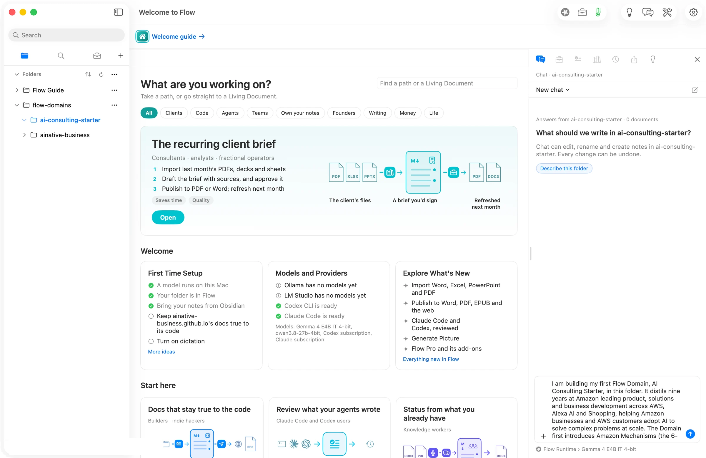

The walk started at 10:55 in the morning on a new Mac identity, with a new folder called `ai-consulting-starter` and nothing in it. Chat was ready anyway: *Answers from ai-consulting-starter · 0 documents. What should we write in ai-consulting-starter?* Manav pinned **Claude Code › Claude subscription** as the route, and every model run in this walk used it.

## A front page, in the author's voice

The first message described the Domain and asked for a README of about 600 words. Chat wrote 788, with the title, who it is for, what a reader will have at the end, and the path through the documents. Two sentences carried a `[check]` mark. These were claims Chat could not stand behind on its own, such as the exact wording of a quote and who said it. A mark stays in the document, and the to-check badge counts it, until the author answers it or resolves it.

## An old AI chat became a reference

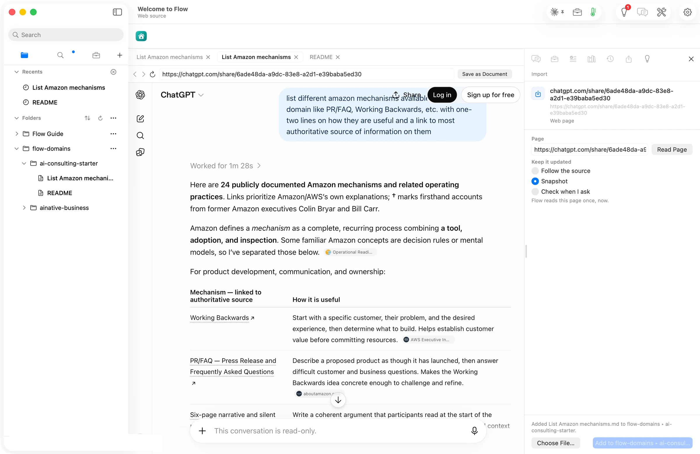

Manav had already asked ChatGPT to list Amazon's mechanisms with a source for each. He brought that shared chat in with **New from Web Page**: the table, all 24 rows and 49 links came across as a document.

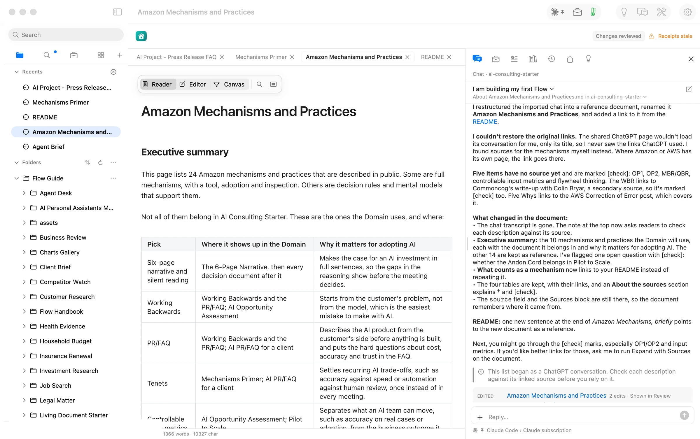

Then he asked Chat to restore the links, restructure the document, rename it *Amazon Mechanisms and Practices*, add an executive summary picking the mechanisms that matter for this Domain, and update the README to point at it. Three minutes later, Review held 17 changes across the two files. Chat said plainly that it could not load the shared page, so it found sources itself: 14 public pages. It marked the six mechanisms it could not source with `[check]` instead of guessing.

## Ideas picked a Skill for a section

Pressing **Suggest** in Ideas read the README's sections and named a Skill for two of them. It offered a **Visual Explainer** for *Amazon Mechanisms, briefly* and a **Guided Exercise** for *How to use this Domain in Flow*, each with a sentence on why it fits.

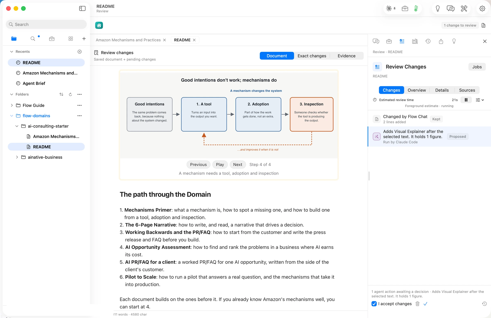

The Visual Explainer's sheet showed what it would read (279 words), its five steps and its cost: *Included in a subscription you already pay for*. About a minute after **Run Skill**, the figure was waiting in Review, right after the section it read: *Good intentions don't work; mechanisms do*, built in four steps a reader can play. Manav kept it.

## The next document, from his own pages

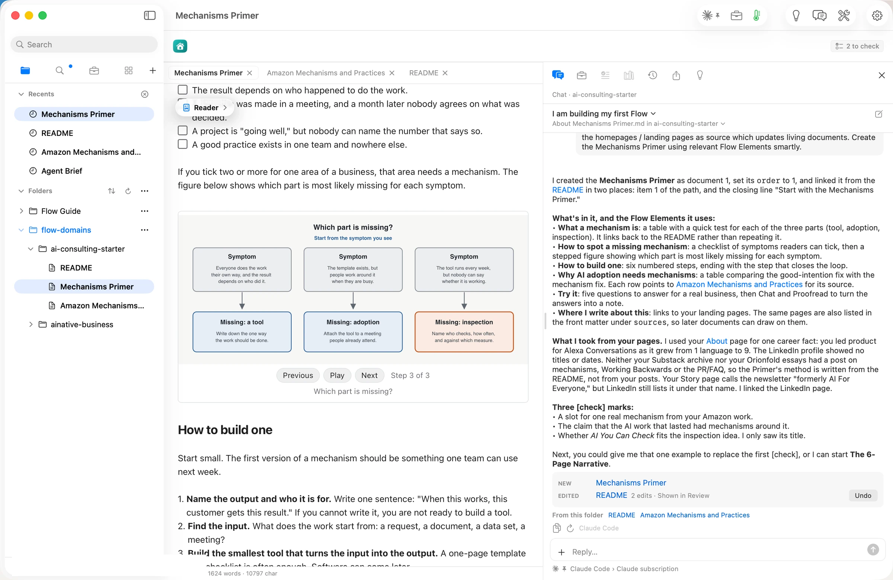

Next, Manav asked Chat to read his LinkedIn profile, his newsletter, his Substack and his story on orionfold.com, and to build the **Mechanisms Primer** with Flow Elements. In under two and a half minutes Chat created it. The document had 1,624 words with a checklist of symptoms a reader can tick, tables, a stepped figure called *Which part is missing?*, and a *Try it* section. It linked the README to it in two places, and it said what it found on his pages and what it did not. It found one real career example and Alexa Conversations growing from one language to nine, and no post of his on mechanisms yet. Three claims went in with `[check]`.

The same pattern made the PR/FAQ document, 1,060 words. Chat then asked two questions back instead of deciding for him. What should it be called, and where does it sit on the path?

## Figures you can press and step through

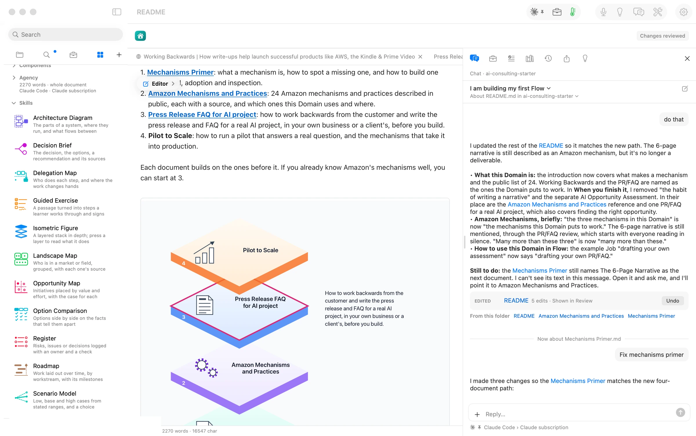

An **Isometric Figure** drew the path through the Domain as a stack of glass layers, one per document. Press a layer and it lifts, with a note on what that document does.

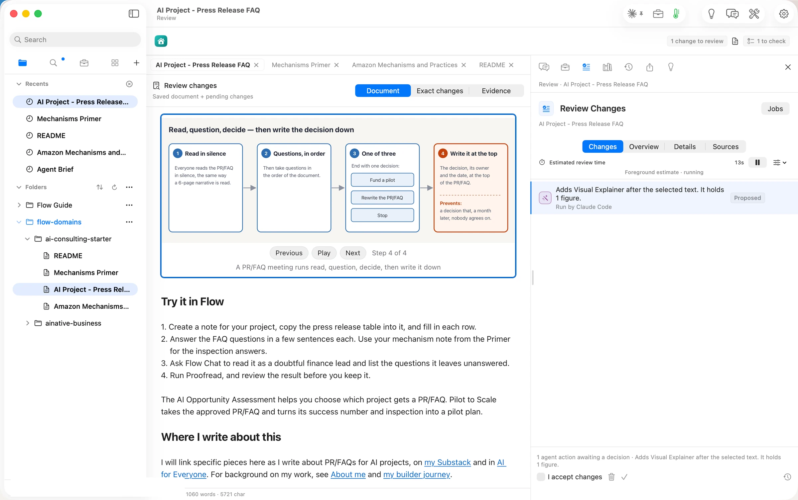

On the PR/FAQ document, Ideas made four suggestions. A Visual Explainer on *Run the review*, a 75-word section, came back in under 30 seconds. Its steps were read in silence, questions in order, one of three decisions, then write the decision down.

## Review changed the plan, and the source followed

The README's first path had six documents. Reading them back, Manav cut it to four. They are the Mechanisms Primer, Amazon Mechanisms and Practices, the PR/FAQ for an AI project, and Pilot to Scale. He asked Chat to bring every document in line with the new path, and each change waited in Review. A sixth file, *Flow PR-FAQ*, is a worked example of the method. It is the PR/FAQ for Flow itself.

## Publishing is yours, not Chat's

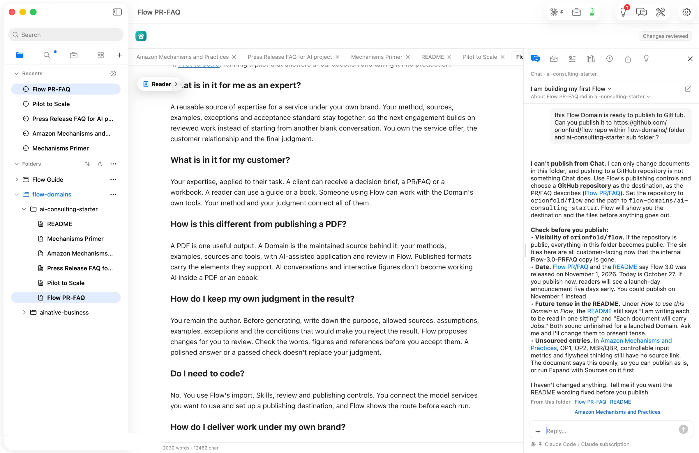

When Manav asked Chat to publish the folder to GitHub, it said no: *I can't publish from Chat. I can only change documents in this folder.* Then it listed what to look at first. The repository is public, a date needs correcting, a few sentences are still in the future tense, and some entries are still marked to check.

So he did it himself. **Publish ▸ GitHub Repository**, destination `orionfold/flow/flow-domains/ai-consulting-starter`, then **Publish to GitHub**: *6 files sent*. The commit added the six Markdown files, byte for byte, and touched nothing else in the repository. The only setup was a GitHub token, pasted once.

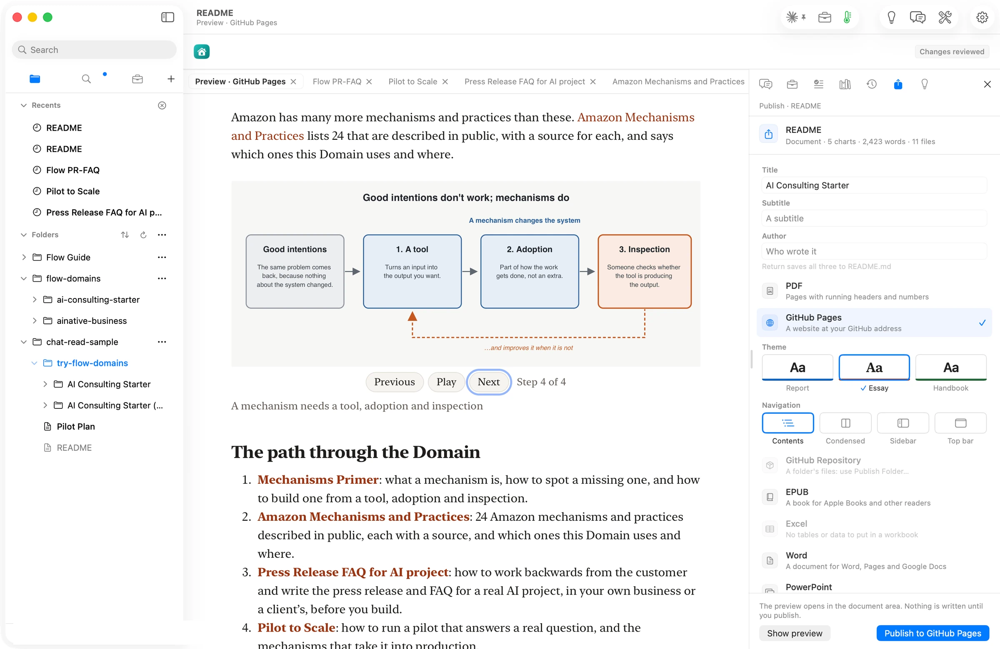

The same folder can go out as a GitHub Pages site, a PDF, Word, Excel, PowerPoint or an EPUB. The preview for GitHub Pages plays the figure step by step. Flow's own interactive features, such as Chat on the Domain, stay in Flow; an exported file is for reading.

## A reader brings it in, and stays current

Into a second folder, **File ▸ New from GitHub…** took the folder's address and read it. The sheet showed *orionfold/flow · flow-domains/ai-consulting-starter · 6 files*. The six files arrived byte for byte. The sheet also said *No licence stated*, so Manav chose one, CC BY 4.0, added it to the README and published again.

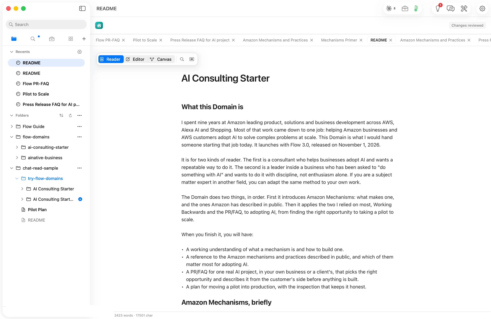

The reader's copy noticed. Its folder showed a blue dot. An update was available.

Pressing it listed what changed: *README · Updated. You have not changed this one, so replacing it loses nothing.* The sheet checks each file against the reader's copy before anything is replaced, and the reader picks what comes in. **Update Selected** brought the new README in.

Last, we tried it the way a stranger would. We used a brand-new Flow on a first launch, holding only the bundled Guide. New from GitHub read *6 files, 75 KB*, the version, and *Licence: CC BY 4.0*. After **Add**, the README opened by itself and its figure played all four steps. No model ran and nothing was spent.

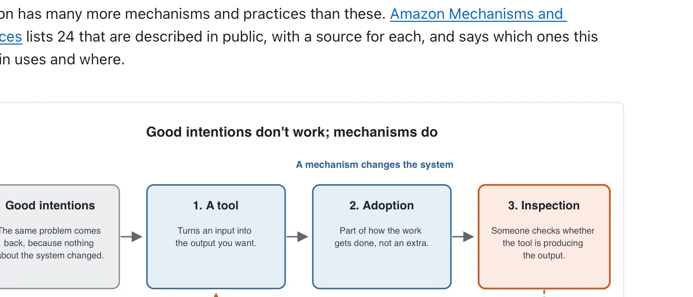

## The numbers

| Figure | Value | Status and source |
| --- | --- | --- |
| Files in the Domain | 6 Markdown files, 75 KB | verified: the New from GitHub sheet and the repository |
| Documents on the path | 4, plus the README and one worked example | verified: the README |
| README, first draft | 788 words, 2 claims marked to check | verified: the file, read back |
| Shared chat brought in | 24 rows, 49 links | verified: the document |
| Sources Chat found for the reference | 14 public pages, 6 mechanisms marked to check | verified: the document and Chat's reply |
| Visual Explainer, press to figure | about 1 minute | verified: clock times on the sheet and the result |
| Mechanisms Primer, request to document | under 2.5 minutes, 1,624 words | verified: shot clock times and the file |
| PR/FAQ figure, press to figure | under 30 seconds | verified: shot clock times |
| Hands-on time, empty folder to published | about 3 hours, across two days | derived: the session clock, counting only the steps Manav took in Flow |
| Files sent on publish | 6, nothing else touched | verified: the commit |
| API spend for the whole walk | $0, every run on the Claude subscription | verified: every run's route line |
| Licence | CC BY 4.0 | verified: the README's front matter and the reader's sheet |

## Your agents, on your Domains

With **Flow MCP**, the Claude Code or Codex you run in Terminal can use your Domains too. In Settings ▸ General ▸ Your agents, open Flow to them as Read or Read and propose. An agent can read a Domain's summary and reading order, read and search its documents, and apply its method to the work it does for you. Whatever it proposes comes back to Review Changes under its name, and Flow keeps a log of each call.

## Try it

Get [AI Consulting on GitHub](https://github.com/orionfold/flow/tree/main/flow-domains/ai-consulting-starter). In Flow, choose **File ▸ New from GitHub…**, paste the folder's address and press **Add**. Bringing a Domain in is free on Base; Chat on it needs Flow Pro. Start with the Mechanisms Primer, pick one real customer task, and work along the path to a PR/FAQ for it.

If your field has a method of its own, the [blueprints on the Domains page](/domains/#dm-blueprints) are yours to take. Each is a plan for a Domain in one field, built the way this one was. Build it, put your name on it, and launch it as your Domain.
