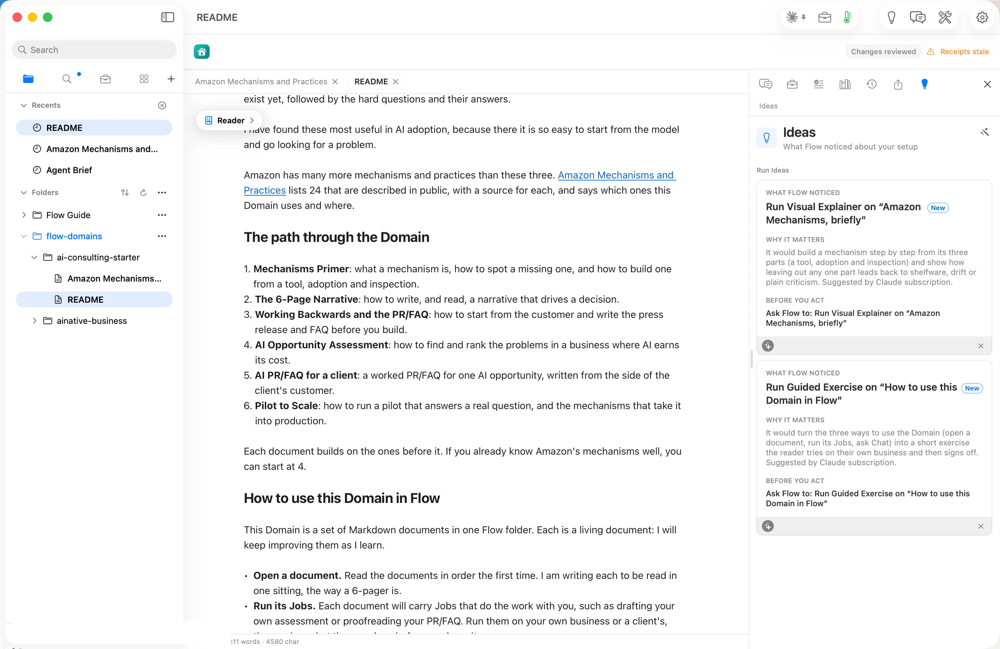

You are the finance person for companies too small to have one full time. You close the month, build the pack, and sit with the board to say what the numbers mean. The cadence never changes. The judgment is what they pay for, and today it lives in your head, in a spreadsheet only you understand, and in whatever last quarter's deck happened to say.

This page is a blueprint for a Flow Domain that carries that judgment. It is not built. Only one Domain exists today, [AI Consulting Starter](/domains/ai-consulting-starter/), and its launch story is the walkthrough for every step below. The point of this page is to show you what yours could hold, and to ask you to build it.

## The opportunity

Finance teams have adopted AI, and then stalled. Gartner found that [59 percent of finance functions](https://www.gartner.com/en/newsroom/press-releases/2025-11-18-gartner-survey-shows-finance-ai-adoption-remains-steady-in-2025) used AI in 2025, almost unchanged from 58 percent in 2024 after a jump from 37 percent the year before. At large companies the picture is further along. Deloitte's CFO Signals found [93 percent of CFOs](https://www.deloitte.com/us/en/insights/topics/business-strategy-growth/2q-2026-cfo-signals-survey.html) say their business uses AI, and 44 percent use it for planning and budgets. In FP&A teams, the people who build the packs, only [23 percent use AI at least monthly](https://www.financialprofessionals.org/training-resources/resources/survey-research-economic-data/Details/afp-fpa-benchmarking-survey-report-technology), while 40 percent are still testing it.

The reason for the stall is trust. A 2026 survey of 270 CFOs by Datarails found finance teams spend [26 percent of their week](https://www.prnewswire.com/news-releases/finance-teams-now-spend-a-quarter-of-their-week-fact-checking-ai-new-datarails-survey-finds-302899700.html) checking or correcting AI output, and only 5 percent would trust AI to produce a board-ready report without a person reviewing it. The draft is fast. Knowing whether it is right is not. A method that carries your rules, your thresholds and your review is the thing missing from the AI tools these teams already pay for.

The demand for people like you is rising while the supply of finance talent falls. CFOs expect to grow headcount by only [2 percent in 2026](https://www.gartner.com/en/newsroom/press-releases/2026-02-10-gartner-research-reveals-cfos-budget-plans-prioritize-grotwth-functions-tech-and-ai-in-2026), down from 6 percent, while three in four raise their technology budgets. Accounting degrees fell [6.6 percent](https://www.aicpa-cima.com/news/article/accounting-firms-report-strong-hiring-outlook-aicpa-report-finds) in a year. One marketplace for part-time executives reported demand for fractional roles up [149 percent](https://www.prweb.com/releases/fractional-hiring-surges-149-as-businesses-rethink-the-full-time-standard-report-302852670.html) year over year, with finance the most wanted role. And the custom GPT some advisors used to package their method [retires on December 11, 2026](https://help.openai.com/en/articles/20001519-custom-gpt-retirement-and-migration-faq). A Domain is plain files in your own GitHub. Nobody can retire it.

## The signals

| Figure | Value | Source |
| --- | --- | --- |
| Finance functions using AI | 59 percent in 2025, 58 in 2024, 37 in 2023 | source: [Gartner, Finance AI Adoption Remains Steady in 2025](https://www.gartner.com/en/newsroom/press-releases/2025-11-18-gartner-survey-shows-finance-ai-adoption-remains-steady-in-2025), published 2025-11-18, checked 2026-10-28 |
| Large-company CFOs whose business uses AI | 93 percent; 44 percent for planning and budgeting | source: [Deloitte, 2Q 2026 CFO Signals](https://www.deloitte.com/us/en/insights/topics/business-strategy-growth/2q-2026-cfo-signals-survey.html), published 2026-07-23, checked 2026-10-28 |
| FP&A teams using AI at least monthly | 23 percent; 40 percent testing it | source: [AFP, 2025 FP&A Benchmarking Survey, Technology and Data](https://www.financialprofessionals.org/training-resources/resources/survey-research-economic-data/Details/afp-fpa-benchmarking-survey-report-technology), published 2025, checked 2026-10-28 |
| Finance team time spent checking AI output | 26 percent of the week; 5 percent trust AI for a board report without review | source: [Datarails, survey of 270 CFOs](https://www.prnewswire.com/news-releases/finance-teams-now-spend-a-quarter-of-their-week-fact-checking-ai-new-datarails-survey-finds-302899700.html), published 2026-10-06, checked 2026-10-28 |
| US financial managers | 879,700 jobs in 2025, growing 10 percent to 2035 | source: [US Bureau of Labor Statistics, Occupational Outlook Handbook](https://www.bls.gov/ooh/management/financial-managers.htm), published 2026-08-27, checked 2026-10-28 |
| US financial analysts | 443,100 jobs in 2025, growing 7 percent to 2035 | source: [US Bureau of Labor Statistics, Occupational Outlook Handbook](https://www.bls.gov/ooh/business-and-financial/financial-analysts.htm), published 2026-08-27, checked 2026-10-28 |
| CFO headcount growth expected for 2026 | 2 percent, down from 6; 75 percent raising technology budgets | source: [Gartner, CFOs' Budget Plans for 2026](https://www.gartner.com/en/newsroom/press-releases/2026-02-10-gartner-research-reveals-cfos-budget-plans-prioritize-grotwth-functions-tech-and-ai-in-2026), published 2026-02-10, checked 2026-10-28 |
| US accounting degrees, 2023 to 2024 | 55,152, down 6.6 percent | source: [AICPA, 2025 Trends Report](https://www.aicpa-cima.com/news/article/accounting-firms-report-strong-hiring-outlook-aicpa-report-finds), published 2025-10-27, checked 2026-10-28 |
| Demand for fractional executives | Up 149 percent in a year; finance the top role at 22 percent | source: [Fractional Jobs via PRWeb](https://www.prweb.com/releases/fractional-hiring-surges-149-as-businesses-rethink-the-full-time-standard-report-302852670.html), published 2026-08-18, checked 2026-10-28 |

Each figure measures something narrower than it sounds. Surveys count who answered. Vendor research counts a vendor's view. One marketplace's numbers are one marketplace. Read them as a direction, not a forecast.

## What your Domain holds

The figure at the top of this page is the folder as it could sit on GitHub. Six Markdown files. Here is what each one does.

**The README** is the front page. It says who the Domain is for, what a reader will have at the end, and the order to read the documents in. A stepped figure shows your month from close to board. An isometric figure maps the path.

**Monthly Reporting Method** is the heart of it. The steps from a closed ledger to a board pack, who does each one, and what must be true before the pack goes out. The sign-off is an Approval Card, so the record of who approved what stays with the month.

**Judgment Rules** is what clients pay for. How you read gross margin, cash and runway. The thresholds you act on, and what you do when one is crossed. Where each rule came from, with a link. The rules you are still testing are marked, and Flow counts the marks until you settle them.

**Scenario Model Template** builds low, base and high cases from ranges the reader states, and says which decision the model is there to inform. A Scenario Model Skill draws it. Charts draw themselves from the rows.

**Board Pack Template** is the pages, their order, and the one paragraph at the front that says what happened and what you recommend. A stepped figure shows a reader how the paragraph is built from the numbers.

**Worked Example** is one pack for a made-up company, filled in end to end, with the judgment calls explained. A reader learns more from one finished pack than from ten rules.

## How you build it in Flow

The [AI Consulting Starter story](/domains/ai-consulting-starter/) walks every one of these steps on a real screen. Follow it with your own material.

1. **Add an empty folder and choose it.** Chat answers from the folder before any document exists. The walkthrough shows it at [an empty folder, and Chat already in it](/domains/ai-consulting-starter/#an-empty-folder-and-chat-already-in-it).
2. **Ask Chat for the README.** Describe who the Domain is for and what you want a reader to have at the end. Chat writes it in your voice and marks every claim it cannot stand behind. See [a front page, in the author's voice](/domains/ai-consulting-starter/#a-front-page-in-the-authors-voice).
3. **Bring in what you already have.** A past board pack with the company's numbers changed, the article where you first read a rule you still use, a shared AI chat where you once worked out a threshold. New from Web Page turns a page or a chat into a document with its links kept. See [an old AI chat became a reference](/domains/ai-consulting-starter/#an-old-ai-chat-became-a-reference).
4. **Let Ideas pick a Skill.** Press Suggest on your Method document. Ideas reads the sections and names a Skill for each, a Workflow Path for the month, a Scenario Model for the cases. A figure or a form waits in Review Changes until you keep it.

5. **Ask Chat for the next document with your own pages as sources.** The Judgment Rules can be written from your Method and your past packs. Repeat until the path is done. See [the next document, from his own pages](/domains/ai-consulting-starter/#the-next-document-from-his-own-pages).
6. **Review every change.** When you drop a page from the pack or rename a rule, every document that pointed at it follows. See [Review changed the plan, and the source followed](/domains/ai-consulting-starter/#review-changed-the-plan-and-the-source-followed).

## Apply it to a client job

A Domain is for using, not only reading. On close day, open the Domain, start a folder for the client and drop the month's numbers in as a table. Ask Chat to draft the board pack from the Template, applying the Judgment Rules, and to mark every line where a rule fired or where it was unsure. The Method's sign-off tells you what to confirm before the pack goes out. When a board member asks a question you had not planned for, write the answer back into the Rules. The next month starts from what you learned.

The Judgment Rules also answer the trust problem. When a client asks what the AI did and what you checked, the rules are written down, dated and the same for every client.

## Publish it, and keep it current

When the folder is ready, choose Publish and then GitHub Repository. Flow sends the files and nothing else. A reader brings the Domain in with File, then New from GitHub, and the folder's address. Check the repository's visibility first. Your method can be public while every client's numbers stay in their own folder on your Mac.

When you change a threshold and publish again, every reader's copy shows the update as a change they review. They keep their own edits. Nothing is replaced behind their back.

The same source can also become a GitHub Pages site, a PDF, or Word, Excel and PowerPoint files for the board. Chat on the Domain, and the figures a reader steps through, stay in Flow.

## What it costs

Bringing any Domain into Flow is free on Base. Writing with Chat, and Chat on a Domain, need Flow Pro at $10 a month. Publishing to GitHub needs the Publish add-on too, another $10 a month. There is no fee per Domain, so publish one or twenty for the same price. Any AI you connect follows the terms of that service. Publishing does not bring clients on its own. It gives the clients you earn a living copy of your method.

## Start here

Read the [walkthrough](/domains/ai-consulting-starter/) once, end to end. Then add an empty folder in Flow, name it, and describe your month to Chat in three sentences. The README it writes is the first document of your Domain. If you want to talk it through first, the [Domains page](/domains/) has one email address and four questions.
