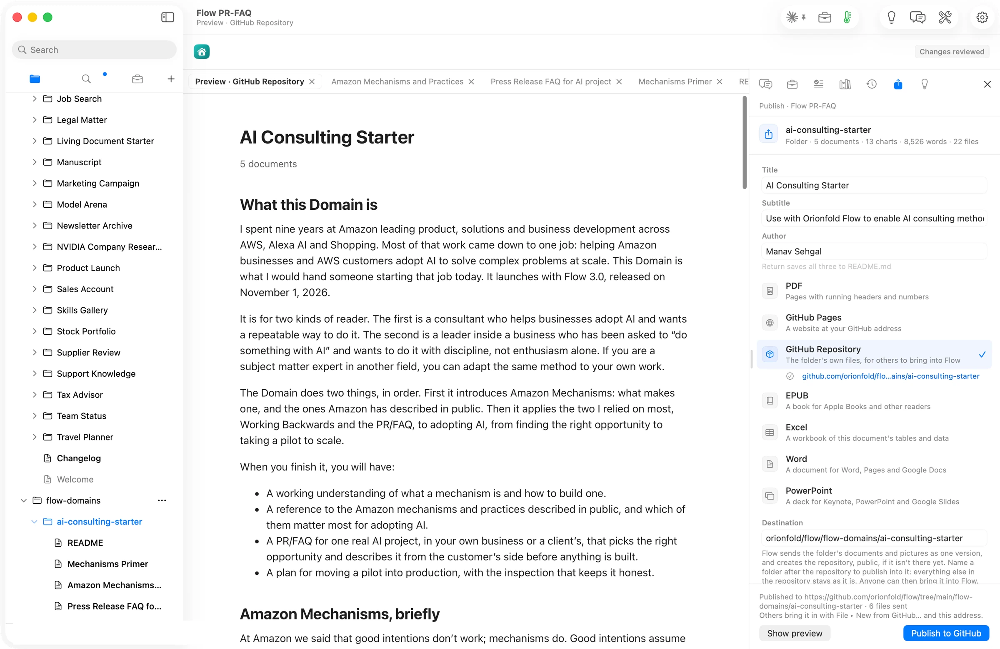
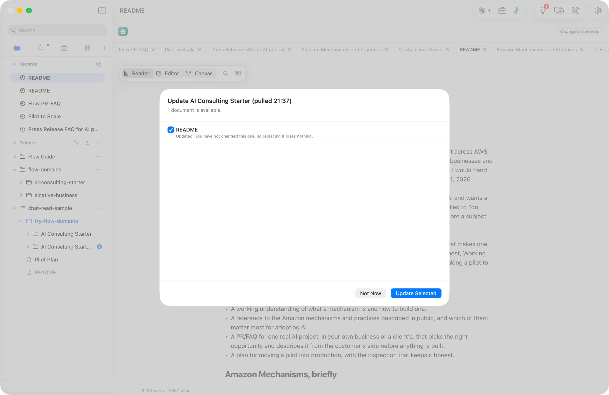

You coach product teams through the same path again and again. Interview eight customers about a recent problem. Draw the opportunity solution tree. That is a tree from one outcome down to the needs you heard and the bets that might meet them. Write the strategy on one page and get the founder to sign it. Sort the roadmap by outcome, not by feature. Tick the launch checklist, then read the numbers a month later. The method is yours. Today it lives in a slide deck, an old whiteboard export, and a custom GPT you built so clients could ask it questions.

This page is a blueprint for a Flow Domain that carries that method. It is not built. Only one Domain exists today, [AI Consulting](/domains/ai-consulting/), and its launch story is the walkthrough for every step below. This blueprint is yours to take. Build it from your own know-how, put your name on it, and launch it as your Domain. If you do, I would like to hear about it.

## The opportunity

Product management has no line of its own in the labor statistics. The nearest is the people who run technology teams. The Bureau of Labor Statistics counts [685,800 computer and information systems managers](https://www.bls.gov/ooh/management/computer-and-information-systems-managers.htm) in 2025 and expects 16 percent growth by 2035. The tools those teams plan with are a market too. Product management and roadmapping tools were worth about [$1.3 billion in 2025](https://www.sphericalinsights.com/reports/product-management-and-roadmapping-tool-market), heading to $3.3 billion by 2035. Every one of those tools ships a blank template. None ships your method.

AI is already in the daily work. Gartner says [79 percent of product teams](https://www.gartner.com/en/product-management/insights/leadership-vision-for-technology-cpo) use generative AI every day. Product Focus found frequent use jumped from [49 to 69 percent](https://www.productfocus.com/product-management-amplified-part-1-the-33-point-gap/) in one year, and 97 percent said it made them more productive. Only 64 percent said the product got better. Productboard found [96 percent](https://www.productboard.com/blog/ai-in-product-management-report) of enterprise product managers use AI consistently, and 65 percent work under a written AI policy. [Four in five](https://productside.com/the-state-of-ai-for-pm-report-2026/) use AI every day. Only 23 percent of their companies have a clear plan with an owner. The gap between use and method is where a coach earns their fee.

The method is what gets overridden. ProductPlan found [over 60 percent](https://productplan.com/ebooks/the-state-of-product-management-report-2026) of prioritization frameworks are set aside by a leader's escalation. A written path, with the reason on each step, is harder to set aside than a slide. There is now a standard to point at, too. [ISO 56001](https://www.iso.org/standard/79278.html), published in September 2024, sets requirements for how an organization manages innovation. And the custom GPT some coaches built to answer their clients' questions [retires on December 11, 2026](https://help.openai.com/en/articles/20001519-custom-gpt-retirement-and-migration-faq). A Domain is plain files in your own GitHub. Nobody can retire it.

## The signals

| Figure | Value | Source |
| --- | --- | --- |
| US computer and information systems managers | 685,800 jobs in 2025, growing 16 percent to 2035; 108,100 added | source: [US Bureau of Labor Statistics, Occupational Outlook Handbook](https://www.bls.gov/ooh/management/computer-and-information-systems-managers.htm), published 2026-08-27, checked 2026-10-29 |
| Product teams using generative AI daily | 79 percent; fewer than half of customers engage with AI features | source: [Gartner, 2026 Priorities for Tech CPOs](https://www.gartner.com/en/product-management/insights/leadership-vision-for-technology-cpo), published 2026, checked 2026-10-29 |
| Product managers using AI frequently | 69 percent in 2026, up from 49; 97 percent more productive, 64 percent better outcomes; 677 surveyed | source: [Product Focus, 2026 Survey of the Product Management Profession](https://www.productfocus.com/product-management-amplified-part-1-the-33-point-gap/), published 2026, checked 2026-10-29 |
| Enterprise product managers using AI | 96 percent consistently; 94 percent daily or often; 65 percent have a written AI policy; 379 surveyed | source: [Productboard, AI in Product Management report](https://www.productboard.com/blog/ai-in-product-management-report), published 2025-10-22, checked 2026-10-29 |
| Daily AI use against a plan | 4 in 5 use AI every day; 23 percent of organizations have a clear AI strategy with an owner | source: [Productside, The State of AI for Product Management Report 2026](https://productside.com/the-state-of-ai-for-pm-report-2026/), published 2026, checked 2026-10-29 |
| Prioritization frameworks overridden | Over 60 percent set aside by leadership escalations; 250 product leaders surveyed | source: [ProductPlan, The State of Product Management Report 2026](https://productplan.com/ebooks/the-state-of-product-management-report-2026), published 2026, checked 2026-10-29 |
| Product management and roadmapping tools, market | $1.314 billion in 2025 to $3.317 billion by 2035, 9.7 percent a year | source: [Spherical Insights, Product Management and Roadmapping Tool Market](https://www.sphericalinsights.com/reports/product-management-and-roadmapping-tool-market), published 2026-06, checked 2026-10-29 |
| ISO 56001, innovation management requirements | Published September 2024, edition 1, 22 pages | source: [ISO, ISO 56001:2024 Innovation management system](https://www.iso.org/standard/79278.html), published 2024-09, checked 2026-10-29 |

Each figure measures something narrower than it sounds. Surveys count who answered. Vendor research counts a vendor's view. A market estimate is a model. Read them as a direction, not a forecast.

## What your Domain holds

The figure at the top of this page is the folder as it could sit on GitHub. Six Markdown files. Here is what each one does.

**The README** is the front page. It says who the Domain is for, what a reader will have at the end, and the order to read the documents in. A stepped figure shows an interview note becoming a bet on a roadmap. An isometric figure maps the path from discovery to launch.

**Discovery Interview Method** is where the path starts. How you find customers to talk to. How you keep the interview on a recent problem and off your idea. How the note is written so it can feed the tree. A Workflow Path draws it. An Interview Intake form lets a team member log each interview in the shape you need. A Guided Exercise lets a new product manager practice the questions before a real call.

**Opportunity Tree and Strategy One-Pager** is the craft. How a pile of interview notes becomes one tree. How you pick the three opportunities worth a bet. How the tree becomes a strategy a founder reads in five minutes. An Opportunity Map draws the tree from the notes. A Decision Brief lays out the choice between opportunities. The one-pager ends in an Approval Card, so the founder's signature stays with the strategy.

**Outcome Roadmap and One-Pager Template** is the backbone of the engagement. The roadmap in now, next and later, with the outcome and its measure on every card. The one-page PRD each bet must earn before anyone builds it. A Roadmap Skill draws it. A template holds the one-pager's shape. Sources shows which interview notes each card came from.

**Launch Checklist and Metrics Review** closes the loop. What must be true before a release ships, who signs it, and how the numbers are read each month after. The checklist is an Approval Card. An Outcome Chart shows each outcome against its target. A Scorecard rates the release against its one-pager.

**Worked Example** takes a made-up software company, Marblebeam, from eight interviews to a signed launch, with every choice explained. The name is invented. A reader learns more from one finished engagement than from ten rules.

## What Flow does for this work

**Chat answers from the folder.** A product manager on a client team opens the Domain and asks how long a discovery interview should run. Chat searches the folder and answers from the Method, with a From this folder row naming the page. When the folder does not say, Chat says so. The README's questions wait in an empty Chat as buttons.

**A Skill draws the opportunity tree.** Select the interview notes and run Opportunity Map. It draws the tree from what the notes say and names what is missing rather than guessing. The figure waits in Review Changes until you keep it. Run Roadmap on the three bets you chose, and the now, next and later columns appear with an outcome on each card.

**A Form signs off the strategy.** The one-pager ends in a Form with one act, Sign off. The founder ticks the bets, types their name and presses the button. Flow writes one signed record beside the document. Change a bet next quarter and the card asks for a new signature. The old record stays.

**A Job keeps the outcome chart current.** The metrics review reads a chart per outcome. A Job keeps that chart current from the client's weekly export, asking only for its rows. On a week when nothing changed, it skips without calling a model. A Budget caps what the review spends in a month. The same goes for a page you watch, like a competitor's pricing page. New from Web Page with Follow the source brings its changes in each time Jobs run.

**The import checklist guards the client's files.** Interview notes arrive in Word, metrics in Excel, the old roadmap in PowerPoint. Each comes in as a document, with tables kept as tables. The Sources tab lists what to check before you rely on it, such as a table to compare with the original. Walk Through with Chat takes the open items one at a time.

**Sources and Change Summary travel with the deliverable.** Every one-pager you hand a client shows what it was made from. Sources marks an interview note that changed since. Change Summary shows what changed lately and on which day. A published page carries both as plain text.

## How you build it in Flow

The [AI Consulting story](/domains/ai-consulting/) walks every one of these steps on a real screen. Follow it with your own material.

1. **Add an empty folder and choose it.** Chat answers from the folder before any document exists. The walkthrough shows it at [an empty folder, and Chat already in it](/domains/ai-consulting/#an-empty-folder-and-chat-already-in-it).
2. **Ask Chat for the README.** Describe who the Domain is for and what you want a reader to have at the end. Chat writes it in your voice and marks every claim it cannot stand behind. See [a front page, in the author's voice](/domains/ai-consulting/#a-front-page-in-the-authors-voice).
3. **Bring in what you already have.** The interview script from your workshop deck. A past one-pager with the client's name changed. The custom GPT's instructions and reference files. New from Web Page turns a page or a shared ChatGPT conversation into a document with its links kept. See [an old AI chat became a reference](/domains/ai-consulting/#an-old-ai-chat-became-a-reference).
4. **Let Ideas pick a Skill.** Press Suggest on your Discovery Interview Method. Ideas reads the sections and names a Skill for each, a Workflow Path for the interview loop, a Guided Exercise for the practice run. A figure or a form waits in Review Changes until you keep it.

5. **Ask Chat for the next document with your own pages as sources.** The Opportunity Tree and Strategy One-Pager can be written from your Method and the past one-pager you brought in. Repeat until the path is done. See [the next document, from his own pages](/domains/ai-consulting/#the-next-document-from-his-own-pages).
6. **Review every change.** When you merge two checklist items or rename an outcome, every page that pointed at it follows. See [Review changed the plan, and the source followed](/domains/ai-consulting/#review-changed-the-plan-and-the-source-followed).

## Apply it to a client job

A Domain is for using, not only reading. A fractional CPO engagement starts with a folder for the client and the first eight interview notes dropped in from Word. Ask Chat to draft the opportunity tree from the notes and the Discovery Interview Method, and to mark every branch the notes do not support. The Opportunity Tree and Strategy One-Pager says how to pick three bets and write the page the founder signs. The Outcome Roadmap and One-Pager Template sorts those bets into now, next and later. When the first release is ready, the Launch Checklist is an Approval Card the team lead signs. A month later the metrics review reads the chart the Job kept current.

When a release misses its outcome, the reason goes into the Worked Example, and the lesson goes back into the Method. The next engagement starts from what you learned. A new product manager can read the Method and the Template on their first day and run their first interview the way you would. That is how the team keeps the method after the coach leaves.

## Publish it, and keep it current

When the folder is ready, choose Publish and then GitHub Repository. Flow sends the files and nothing else. A reader brings the Domain in with File, then New from GitHub, and the folder's address. Check the repository's visibility first. Your method can be public while every client's interview notes, metrics and roadmap stay in their own folder on your Mac.

When a rule changes and you publish again, every reader's copy shows the update as a change they review. They keep their own edits. Nothing is replaced behind their back.

The same source can also become a GitHub Pages site, a PDF, an EPUB, or Word and Excel files for a client's team. Chat on the Domain, and the figures a reader steps through, stay in Flow.

## What it costs

Bringing any Domain into Flow is free on Base. Writing with Chat, and Chat on a Domain, need Flow Pro at $10 a month. Publishing to GitHub needs the Publish add-on too, another $10 a month. There is no fee per Domain, so publish one or twenty for the same price. Any AI you connect follows the terms of that service. Publishing does not bring clients on its own. It gives the clients you earn a living copy of your method.

## Start here

Read the [walkthrough](/domains/ai-consulting/) once, end to end. Then add an empty folder in Flow, name it, and describe your discovery method to Chat in three sentences. Who you interview and what you ask. How the notes become a tree and a one-page strategy. What must be true before a release ships. The README it writes is the first document of your Domain. If you want to talk it through first, the [Domains page](/domains/) has one email address and four questions.
