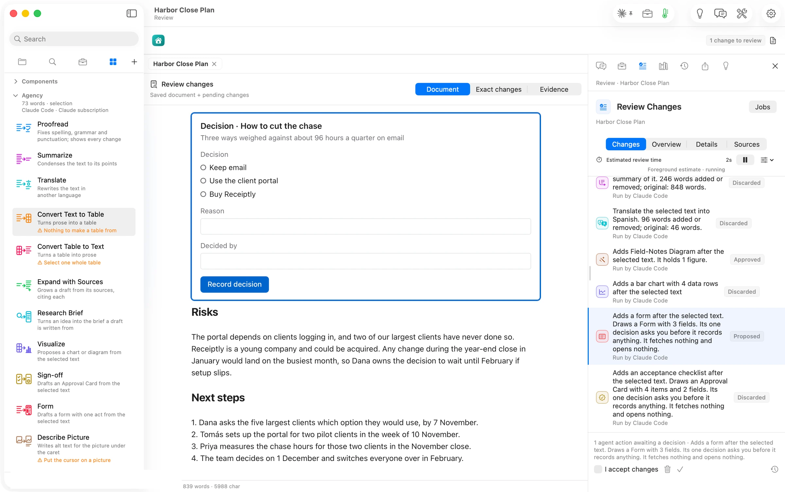

On the options paragraph, Form drafted a decision form. It holds the three options as choices, a **Reason**, **Decided by** and **Record decision**. Review spells out what it is: *Its one decision asks you before it records anything. It fetches nothing and opens nothing.*
