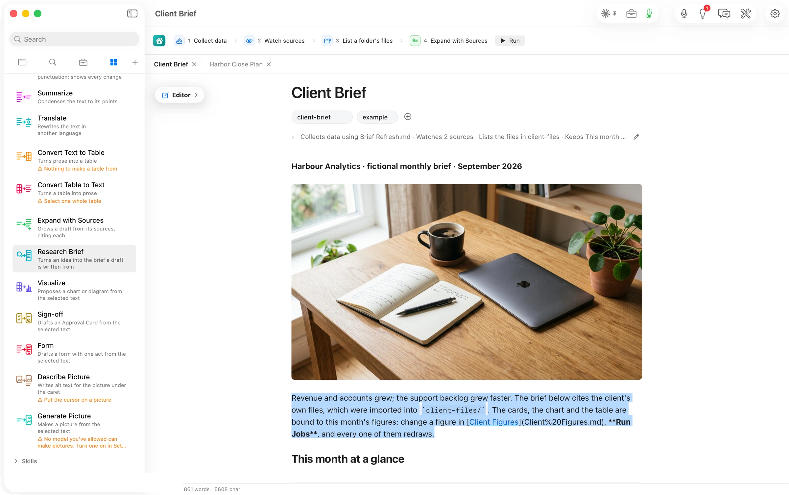

**Describe Picture** writes the sentence a screen reader says for the picture under the caret, and **Generate Picture** makes a picture from the words you select. Both need a model that handles pictures. On this walk's route neither had one, and each card said so in plain words instead of running and failing.
