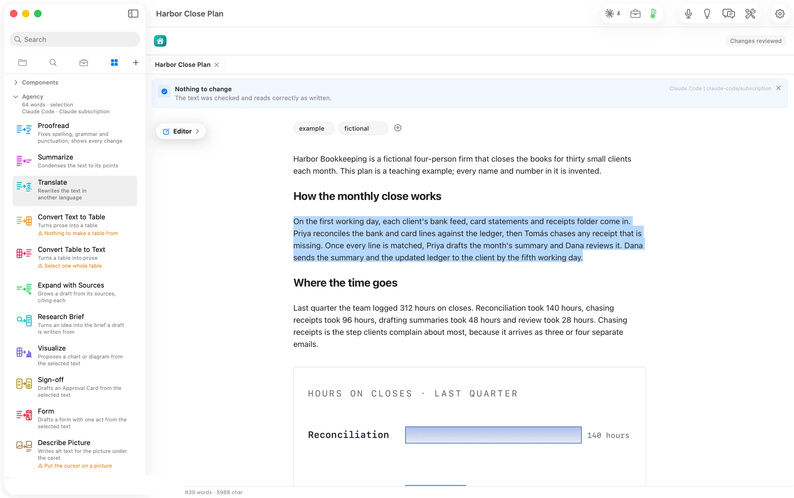

On a clean paragraph Proofread says so: *Nothing to change. The text was checked and reads correctly as written.* No review opens, because there is nothing to keep. When it does find something, every change is shown against the original in Review Changes.
