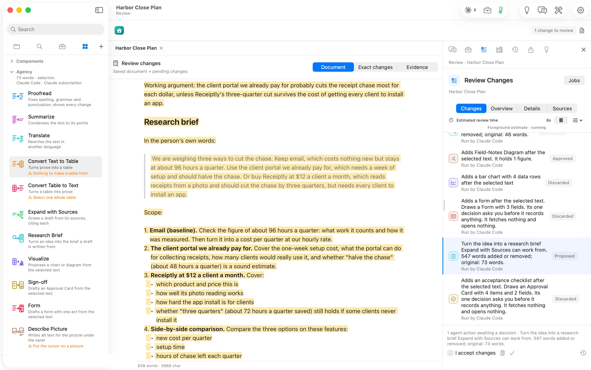

Research Brief took the three options for chasing receipts and wrote the brief a draft would be written from. It opens with a working argument and quotes the person's own words. Then it lays out a scope for each option and the comparison to make. It compares new cost per quarter, setup time and hours of chase left. Review counts *547 words added*; it took 48 seconds. **Expand with Sources** is the action that then writes the draft from those sources, citing each.
