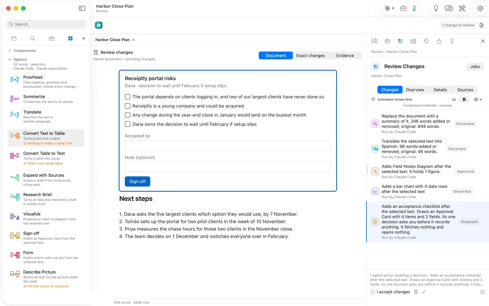

On the risks paragraph, Sign-off drafted an Approval Card: one item per risk, an **Accepted by** field and a **Sign off** button. The Components article shows how signing records a signature beside the document.
