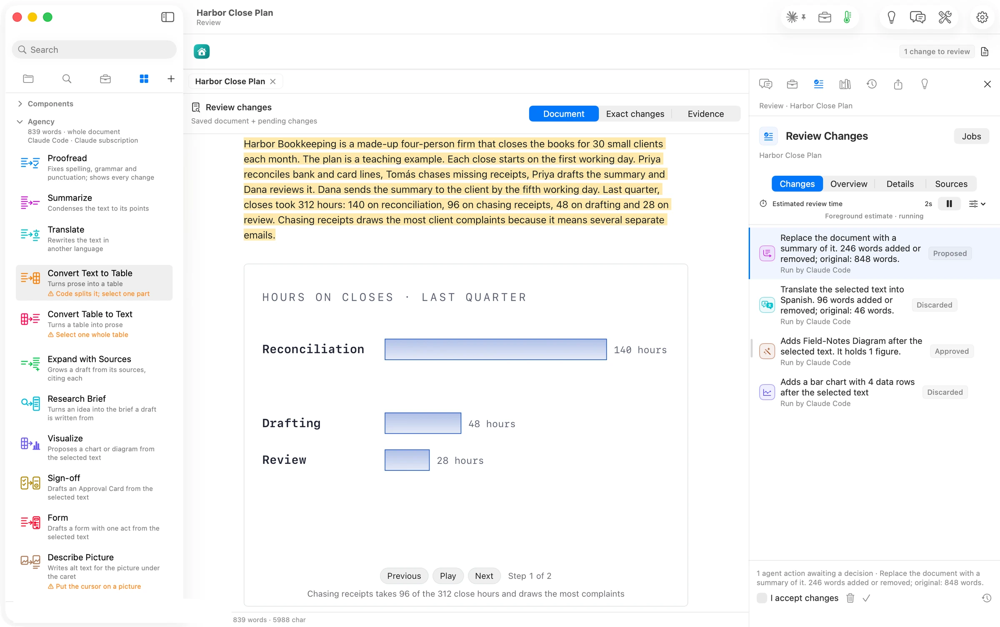

With nothing selected, Summarize read the whole plan and proposed a one-paragraph version. It covers the firm, the close, the hours, the complaint. The figure in the plan was carried through untouched.
