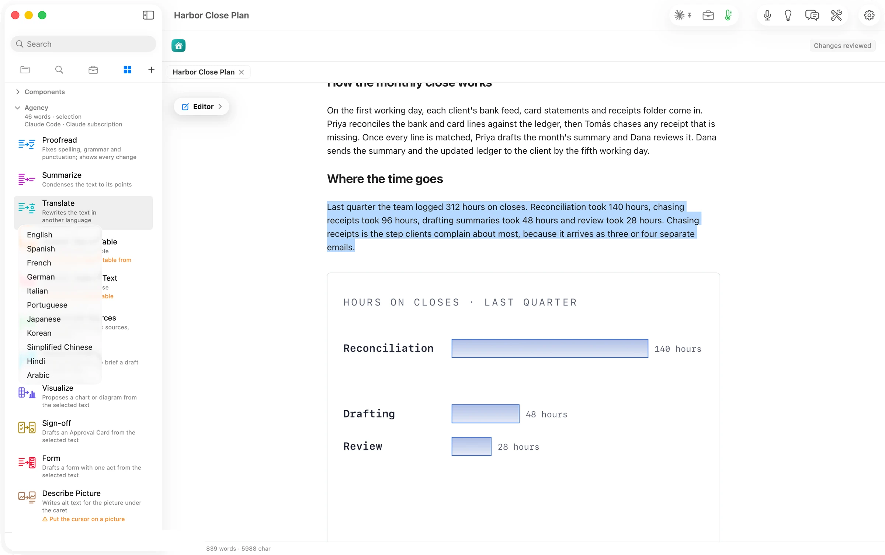
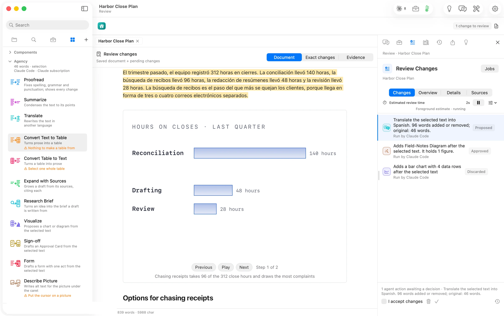

Translate opens a menu of eleven languages under its card.

The selected paragraph came back in Spanish, with every number intact. Review says how much changed: *96 words added or removed; original: 46 words*.
