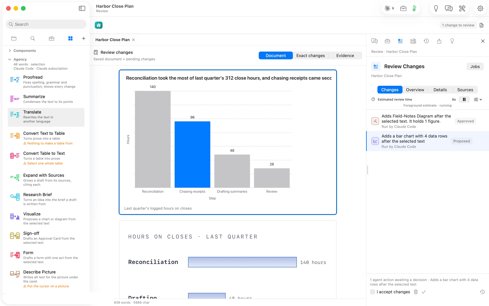

Visualize read the paragraph about where the hours go and proposed a bar chart with the four steps, the one the passage stresses in the accent colour, placed after the paragraph. A very long title can run past the chart's edge in Review; you can shorten it in the chart's editor after you keep it.
