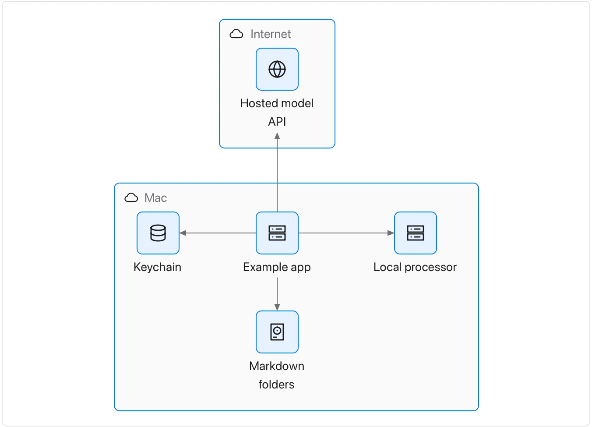

The picture records an intended arrangement; it neither provisions infrastructure nor proves a privacy boundary.

**Takes:** a list of services, the stores they use and the edges between them, grouped by where they run. That is a deployment diagram.

