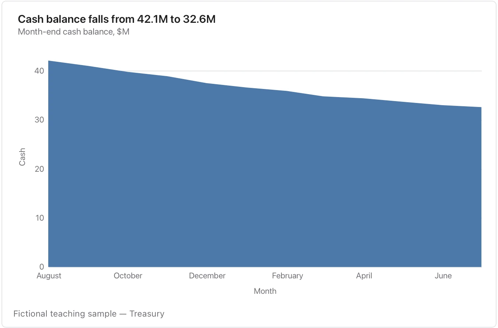

Keep a meaningful zero; a cash balance alone cannot establish runway without a spending basis.

**Takes:** a date column and one cumulative or volume measure, such as total storage, cumulative signups or cash balance, where the filled area reads as the amount.

