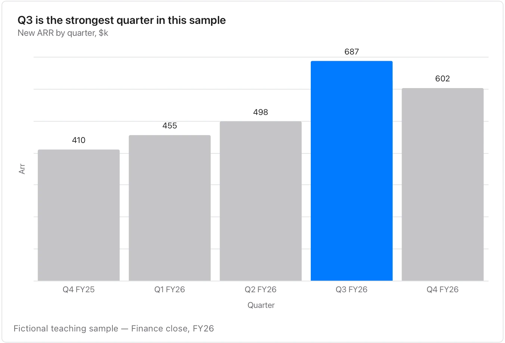

Start at zero when length carries the comparison; use a horizontal orientation for long names.

**Takes:** a two-column table, one category column and one number column, with up to a dozen rows. Name one row in `highlight` and it takes the accent while the rest recede.

