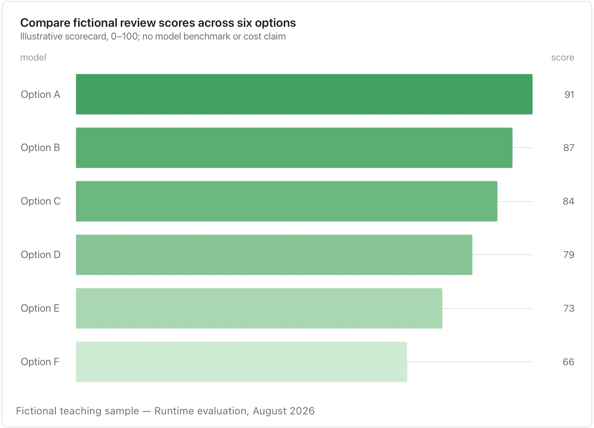

Show the measurement basis; a score without its rubric is not a recommendation.

**Takes:** a ranked table of names and one number, when you want the numbers read as a list as well as compared: a leaderboard, a vendor shortlist, a benchmark.

