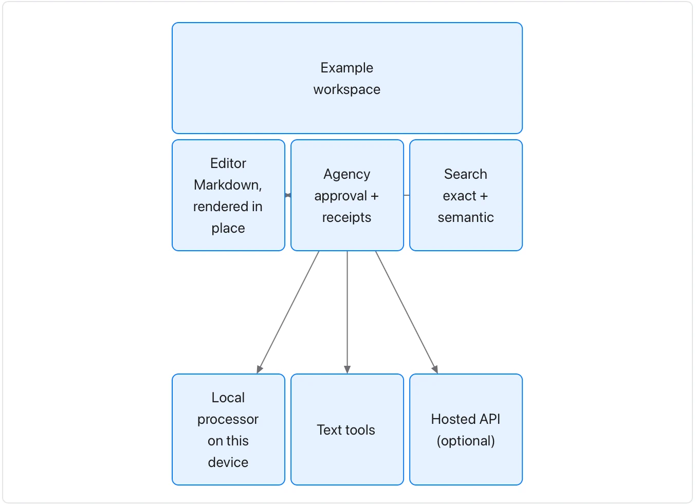

Keep arrows labelled or obvious and avoid implying that visual proximity is a connection.

**Takes:** a description of components and how they sit beside and connect to each other: an architecture sketch, a deployment layout.

