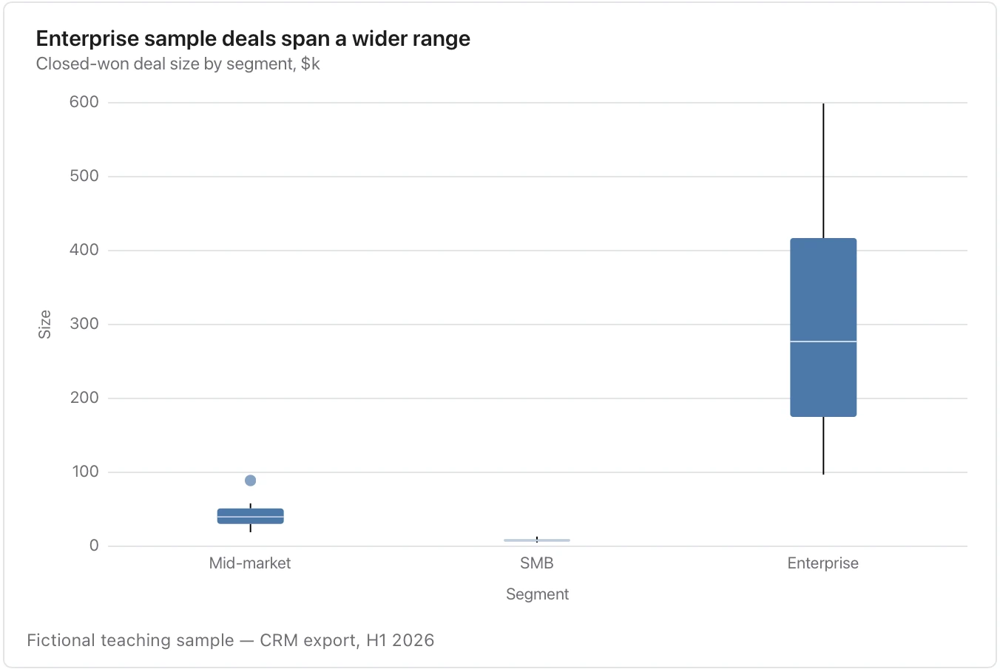

The box hides the individual pattern; a strip plot can be better for a handful of observations.

**Takes:** a category column and a numeric column with several rows per category, such as deal size by segment or score by cohort, summarised as median, quartiles and outliers.

