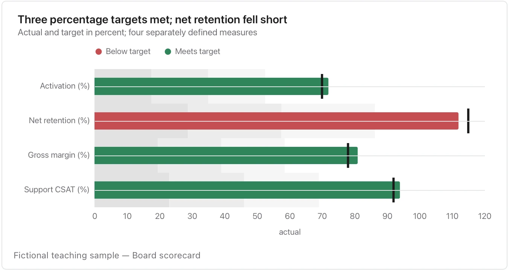

Keep rows in the same unit on a shared axis; put dollars, percentages and days in separate exhibits.

**Takes:** a table of metrics, each with an actual value and a target. That is the quarterly scorecard, where every row is a measure against its goal.

