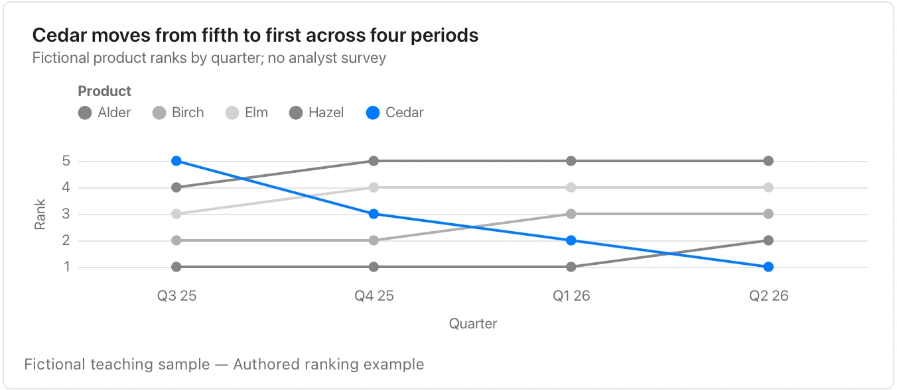

Define the ranking method and ties; moving from second to first says nothing about the size of the underlying gap.

**Takes:** a table of period, competitor and rank: the league table at each point in time, when the story is who passed whom.

