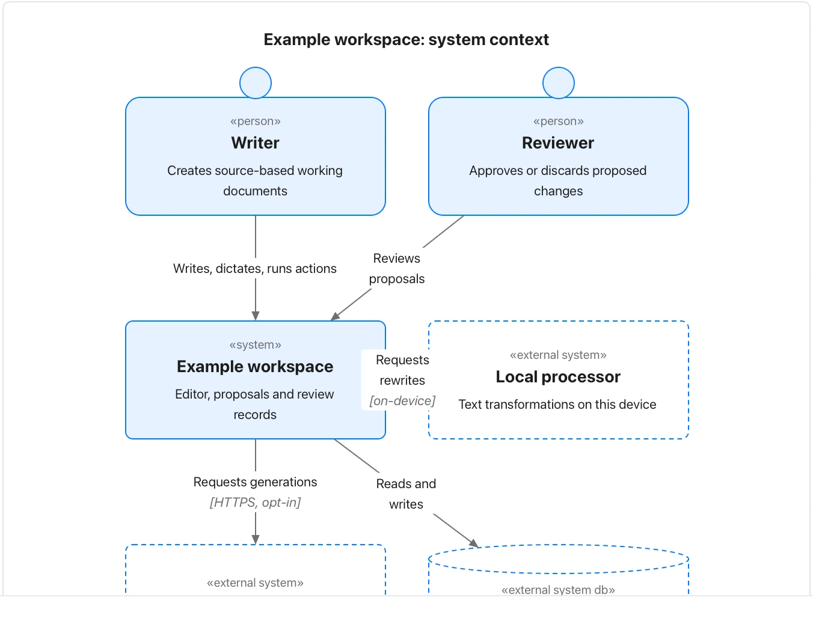

Keep the level of detail consistent and state the system boundary before drilling into components.

**Takes:** a paragraph naming the system, the people who use it, and the external systems it talks to. That is the top of an architecture document.

