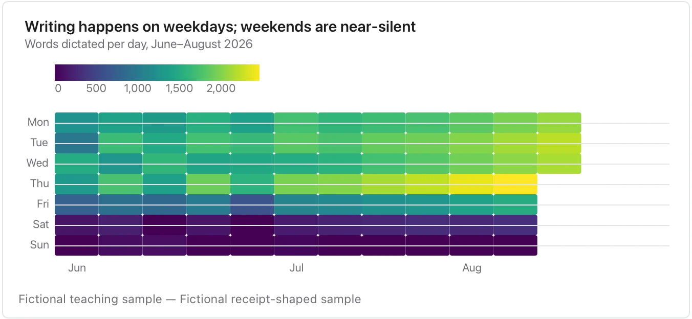

Missing days need explicit treatment; a quiet day is not necessarily a zero or a day when a system was available.

**Takes:** a long table of date and count, such as commits, dictation minutes or support tickets per day, over months, when the weekly rhythm matters as much as the totals.

