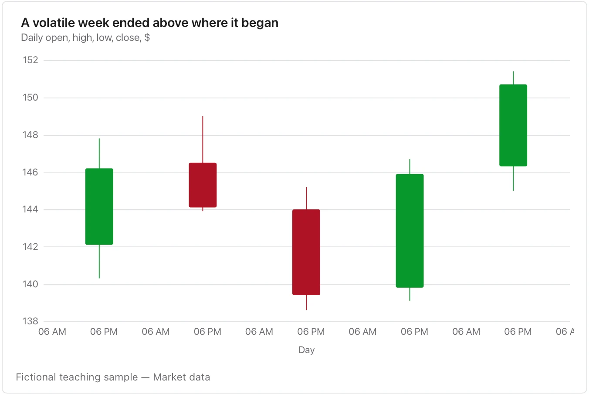

Check the time zone, sampling window and units; it is not an investment recommendation.

**Takes:** a table of date, open, high, low and close. That means market prices, but also any daily range with a start and an end, such as queue depth or token spend.

