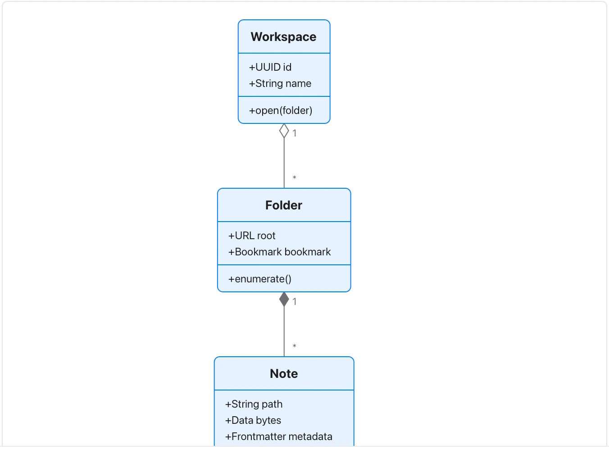

Multiplicity and ownership should have a defined meaning; this is an illustrative model, not Flow source code.

**Takes:** a description of the nouns in a system and how they relate: the data model behind a product, with fields and one-to-many relationships.

