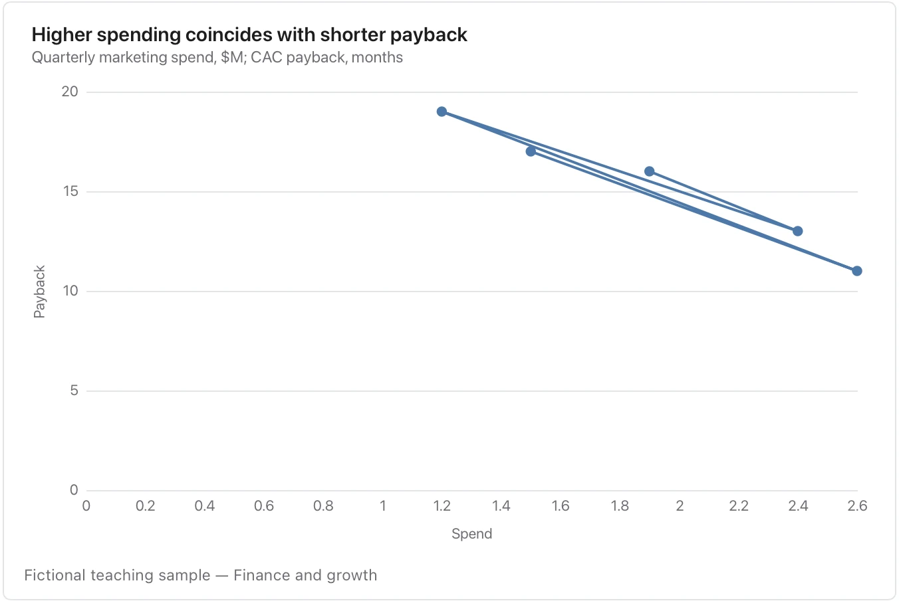

Preserve chronological order and both units; the connecting path is a trajectory, not a regression fit.

**Takes:** a table of period, x-measure and y-measure for one entity, such as price against volume by year or spend against growth by quarter, where the path shows the trajectory.

