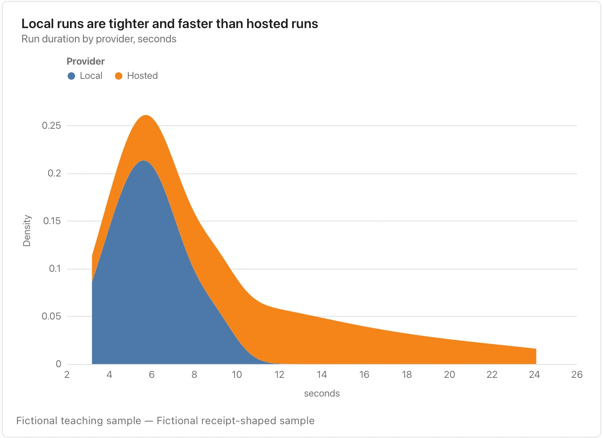

Smoothing and small samples can create or hide peaks; check individual observations before naming distinct populations.

**Takes:** one numeric column, optionally with a group column. It is the same data as a histogram, smoothed, when two groups need overlaying.

