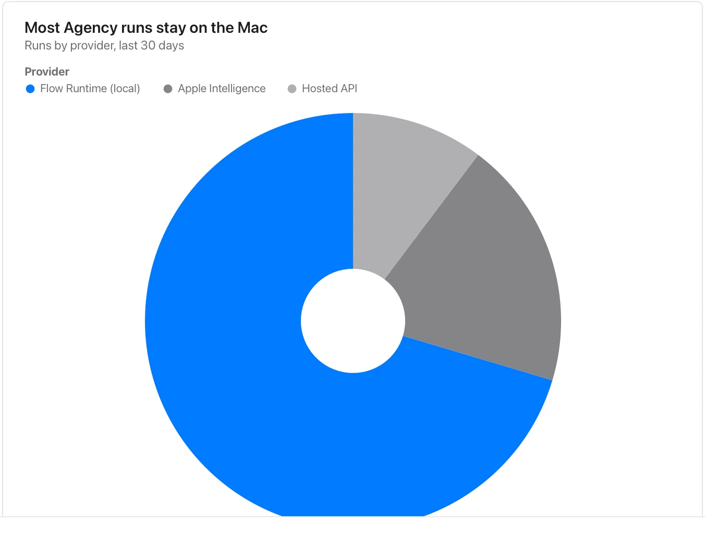

Angles are harder to compare than lengths; keep exact amounts available in a table or paired bar chart.

**Takes:** the same parts-and-share table as a pie, when a headline number belongs in the centre or the chart sits inline beside text.

