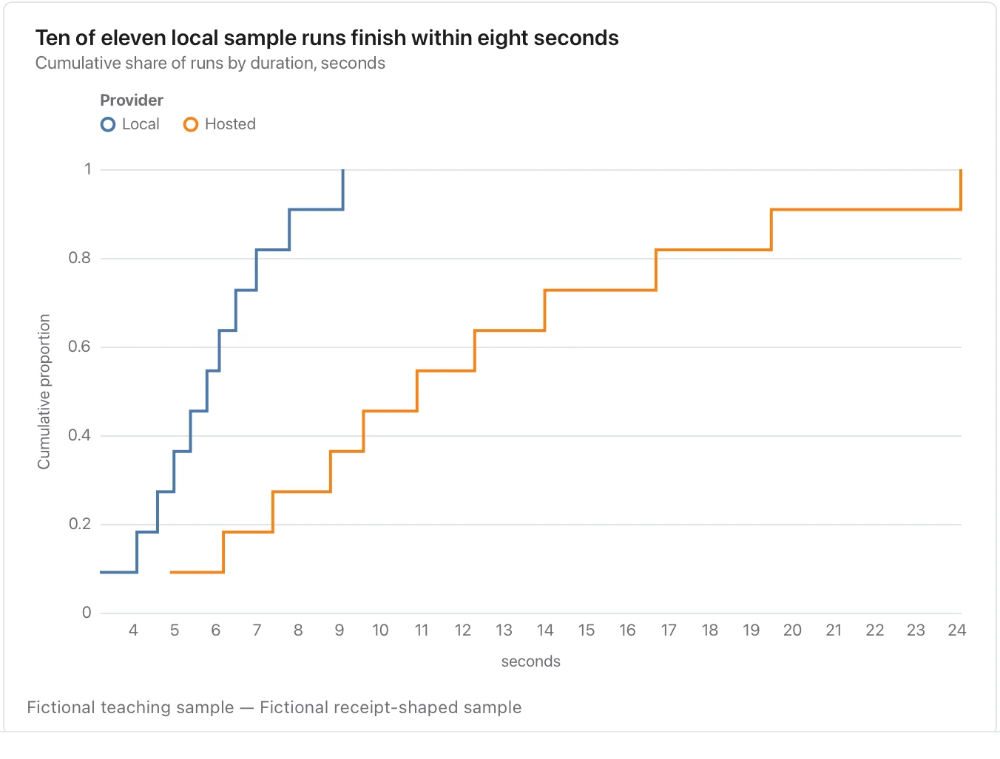

State whether equality counts, name the sample size and remember that this is a sample proportion.

**Takes:** one numeric column, optionally grouped. Use it when the question is "what share finished within N seconds", read straight off the curve.

