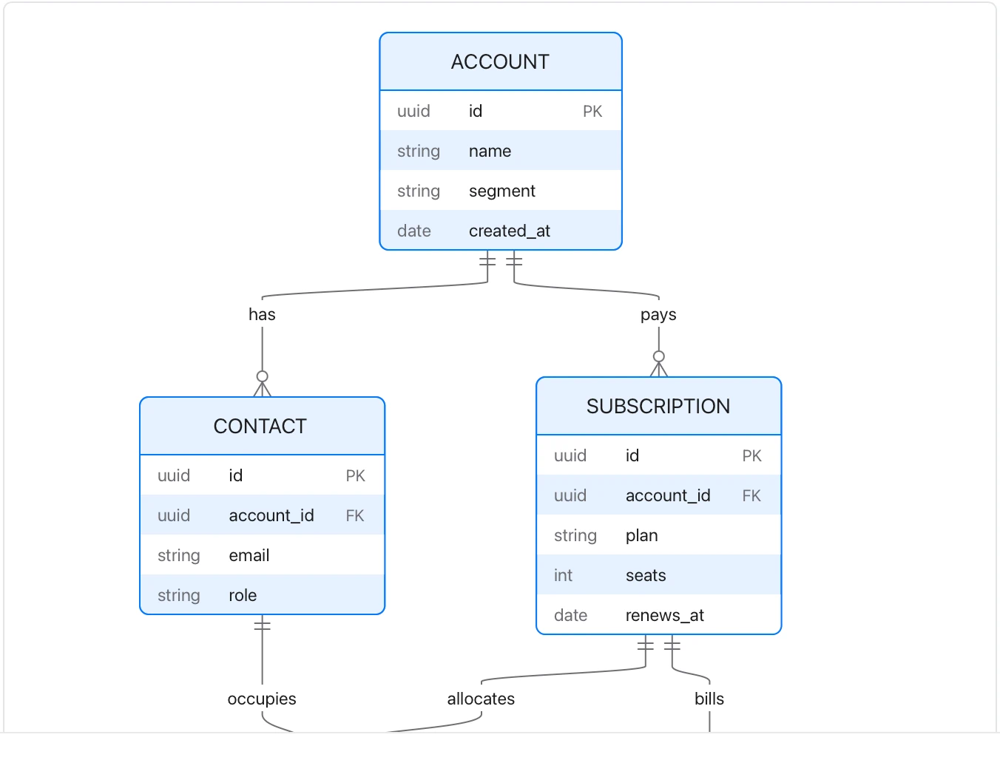

Confirm cardinality with the data owner; a diagram is not a database migration.

**Takes:** a list of tables with their keys and how rows reference one another: a database schema, or a CRM's objects.

