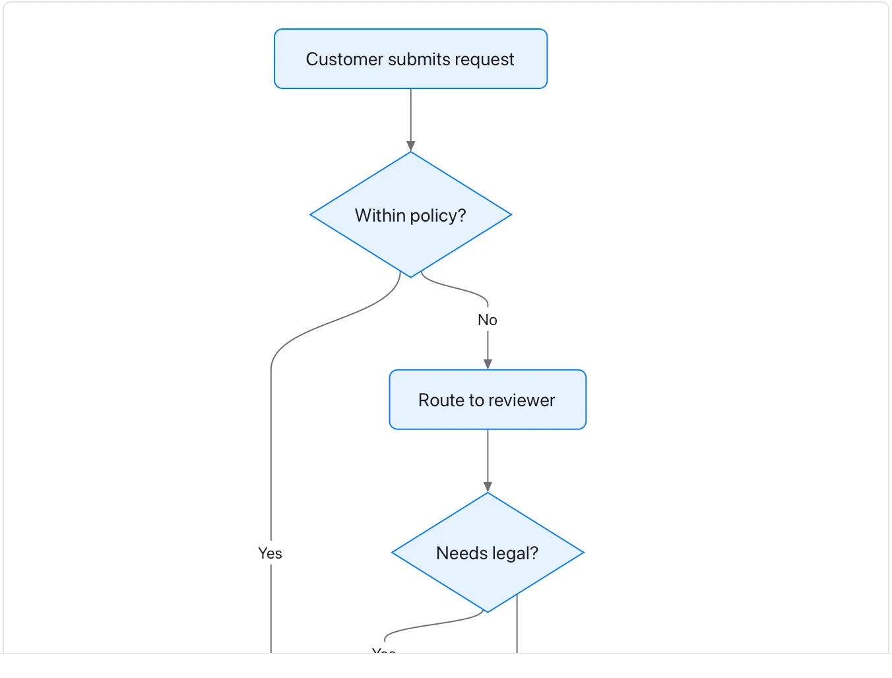

Treat arrows as an authored process; they do not execute an approval or send a message.

**Takes:** a numbered list of steps with decisions written as questions, such as a process, an approval path or a troubleshooting guide.

