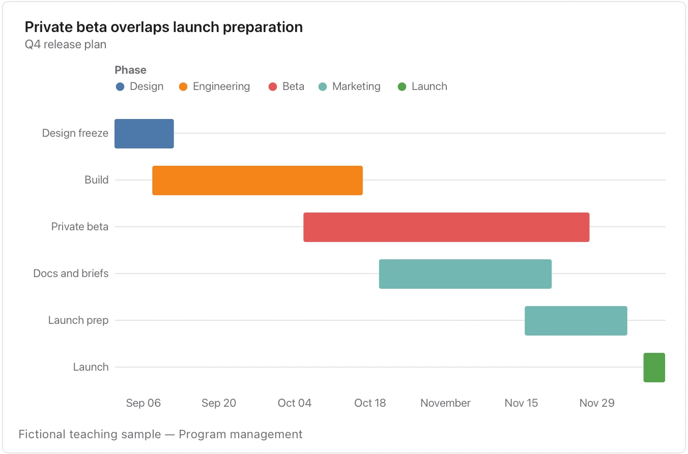

Bars represent the entered schedule; they do not prove work started or that a dependency is satisfied.

**Takes:** a table of tasks with a start date, an end date and an owner or phase: a project plan or release schedule written as rows.

