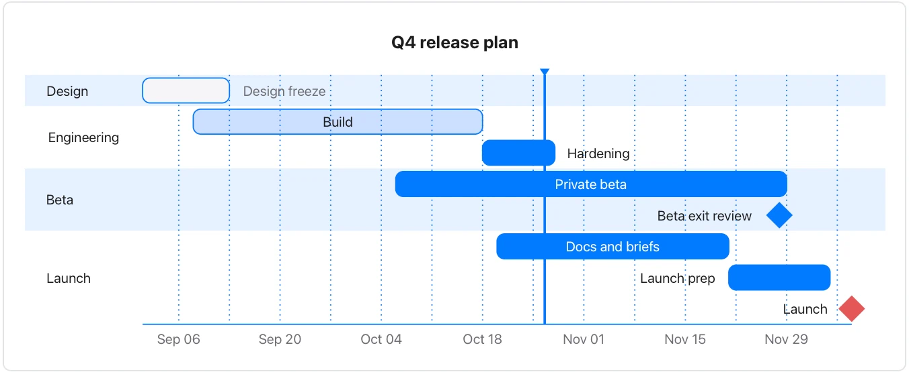

This example is separate from the chart Gantt; neither proves a planned task completed.

**Takes:** a list of tasks with durations and dependencies, in sections: a project plan written as prose, when you want milestones and "after X" dependencies rather than fixed dates.

