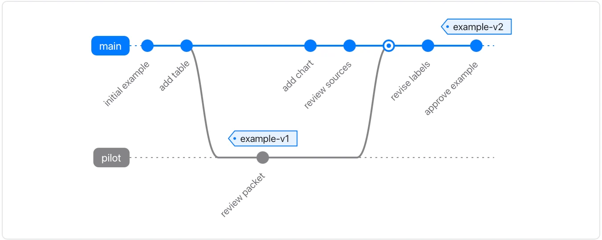

The commits below are fictional labels; the diagram does not inspect or operate a repository.

**Takes:** a description of branches, merges and releases: a release process, or how a feature landed.

