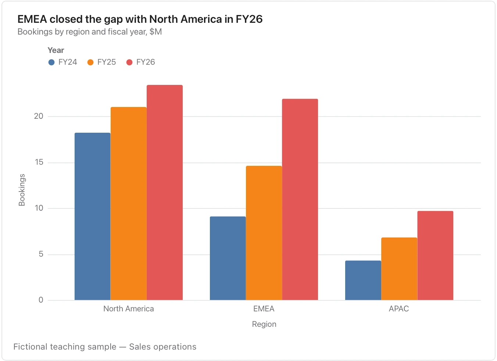

Keep units and group order consistent; many groups are easier to read in separate charts.

**Takes:** a table with a category column, a group column and a value column: the same categories measured under two or three conditions, such as regions across years.

