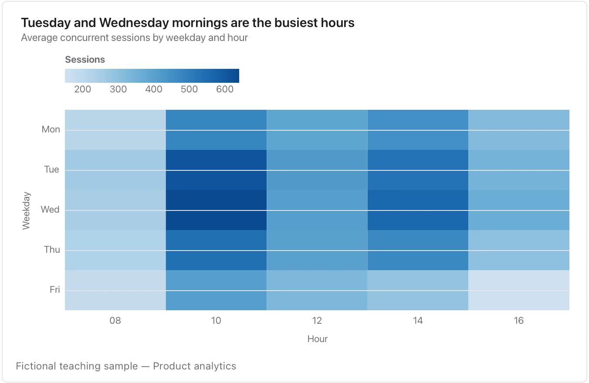

Use one explained colour scale, distinguish missing from zero and keep the scale comparable across panels.

**Takes:** a table with two category columns and a value, such as hour by weekday, feature by segment or team by month, where colour carries the number.

