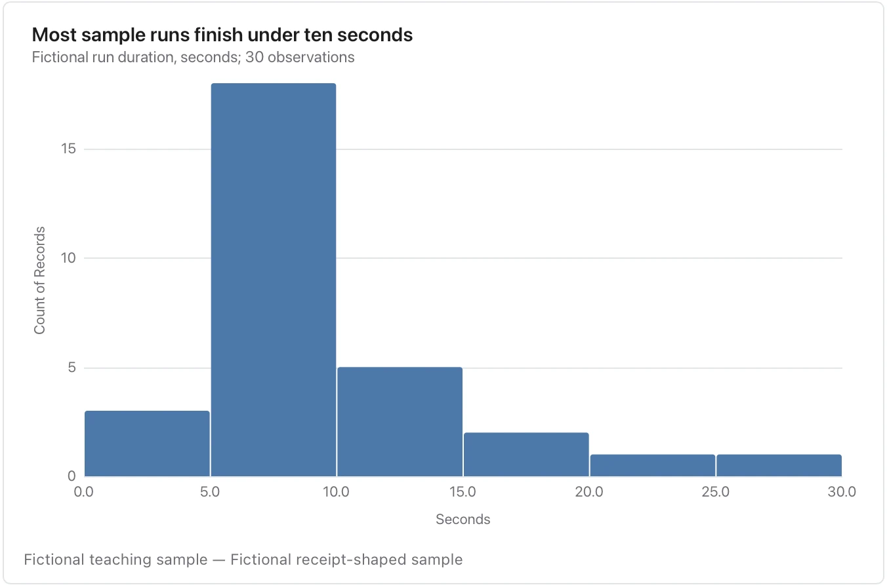

Bin choices change the visible shape; state the sample size and unit and do not treat an empty bin as missing data.

**Takes:** a single numeric column with many rows, such as response times, deal sizes or document lengths, which the chart bins for you.

