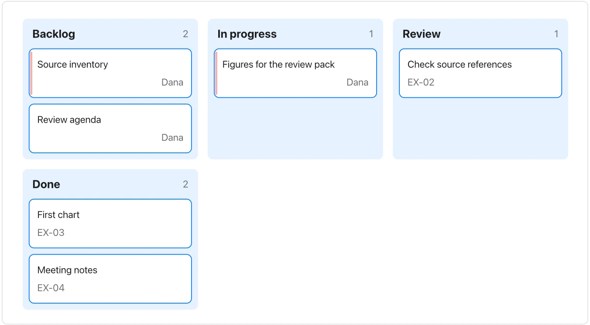

Moving a card in text changes this document; it does not update an external project-management system.

**Takes:** a task list grouped by status. That is the sprint board as columns of cards with owners.

