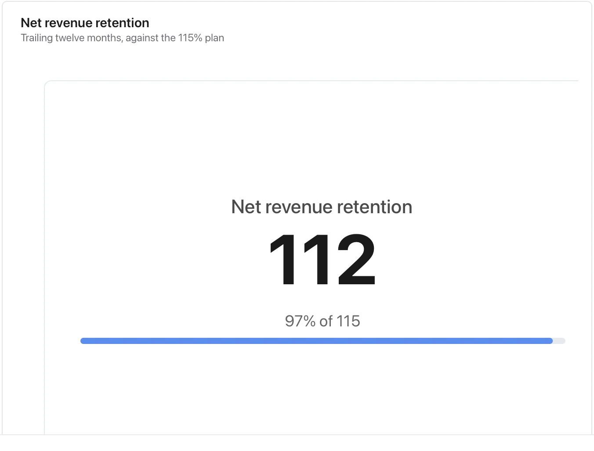

A card needs its period and denominator nearby; it should not replace the evidence behind the number.

**Takes:** a single line or a one-row table naming a metric, its current value and its target: the one number the page is about.

