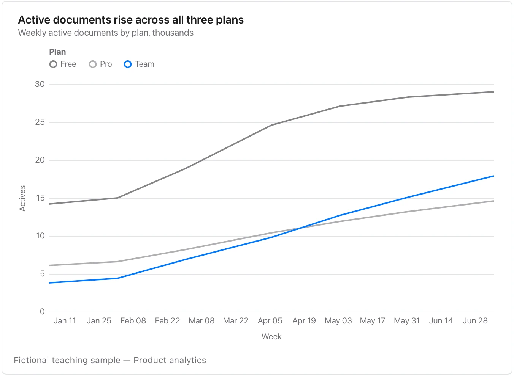

A line joins the supplied points; sparse observations do not establish what happened between them.

**Takes:** a table with a date column and one or more numeric series columns, or a long table of date, series, value, such as weekly actives, monthly revenue or daily latency.

