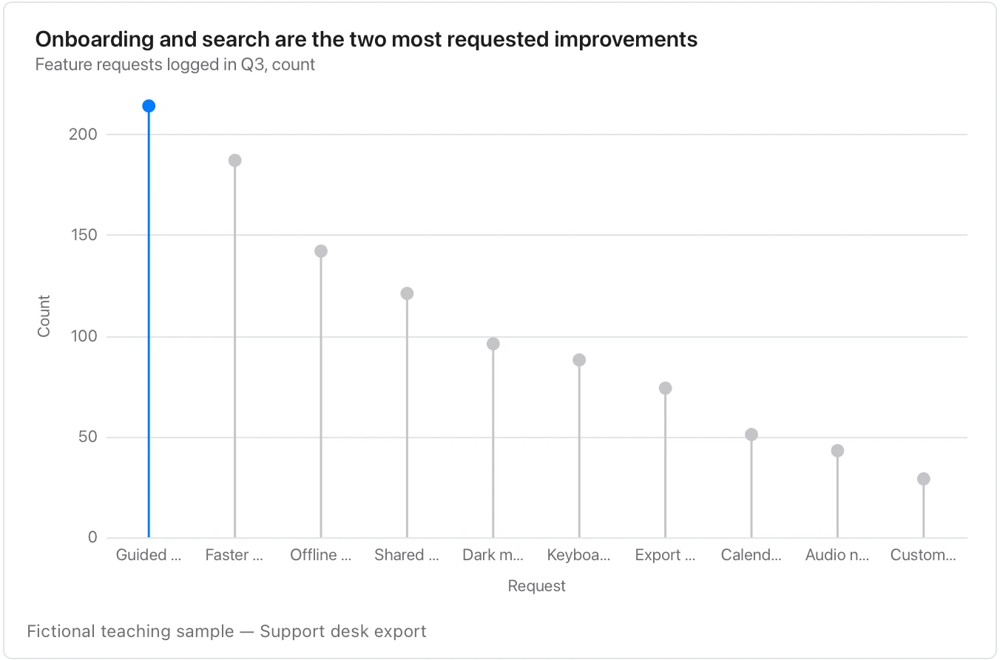

Order the rows intentionally; a decorative stem is not a confidence interval.

**Takes:** the same two-column table as a bar chart, but with many rows or long labels: the thin stem keeps a ranked list of twenty items legible.

