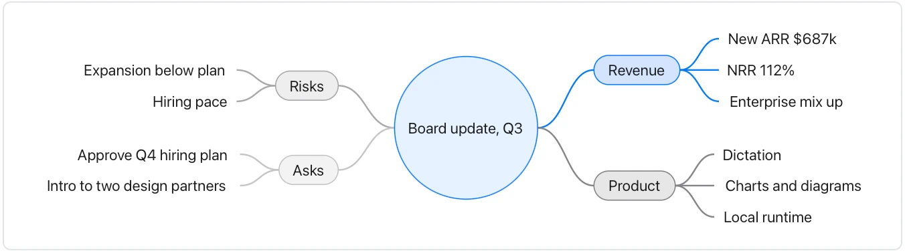

Branches are authored associations, not an automatically maintained knowledge graph.

**Takes:** an outline, a nested bulleted list of topics and subtopics, such as meeting notes, a brainstorm, or a document's structure.

