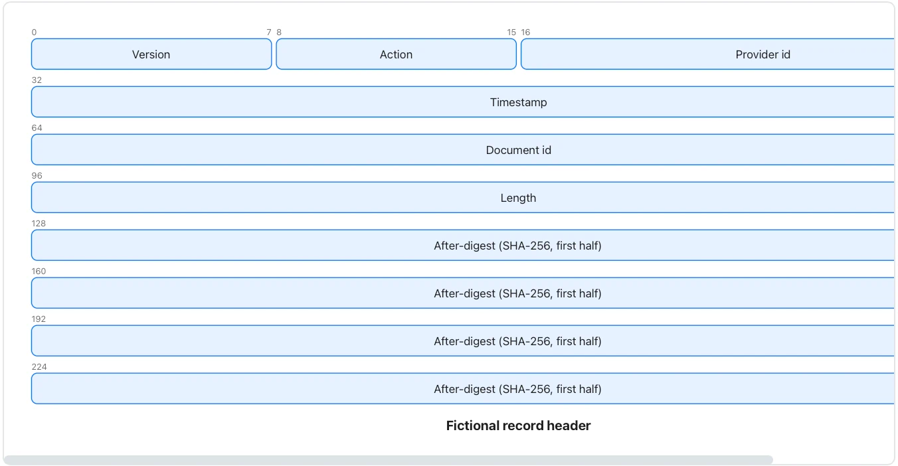

State field widths and total size; do not use this sample as an actual Flow file-format specification.

**Takes:** a field-by-field layout of a binary record or header, with bit offsets, such as a protocol note or a file-format spec.

