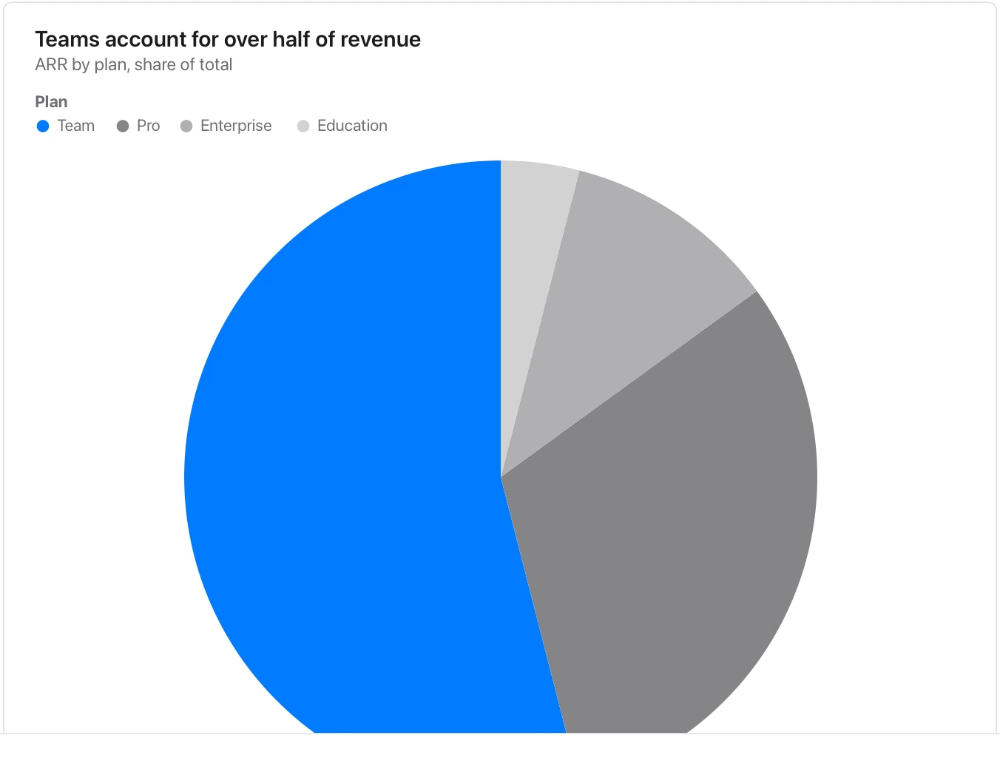

State the denominator; use bars for close values, many categories or overlapping groups.

**Takes:** a short table of parts and their share: five or fewer slices that add to a whole, such as revenue by segment or time by activity.

