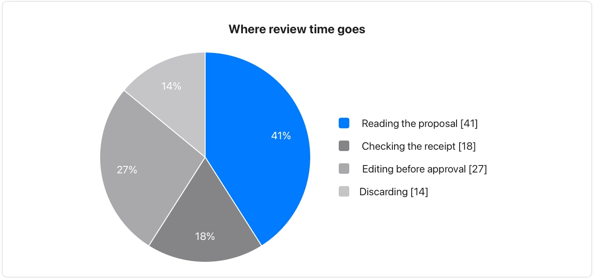

It is authored data; the chart-fence pie is the choice here when values must bind to a local source.

**Takes:** a short list of labels and amounts: the same material as a chart pie, when you want it inside a diagram-only document or rendered on GitHub.

