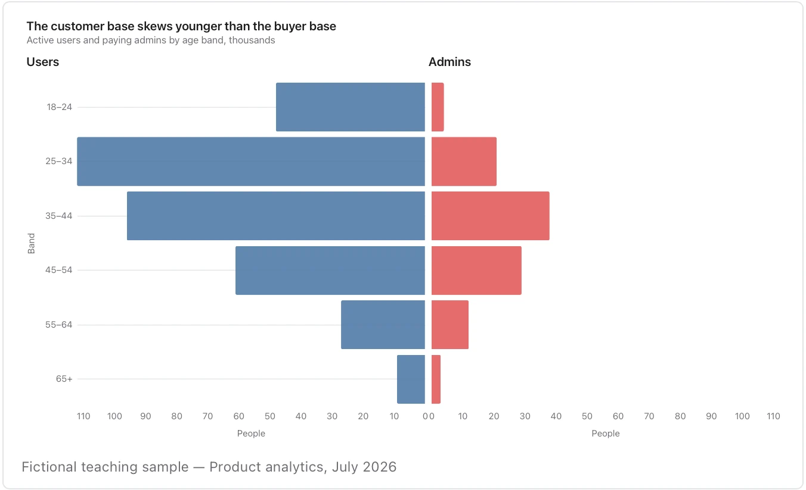

Check whether raw counts or within-cohort percentages answer the question; unequal cohort sizes can dominate the picture.

**Takes:** a table with an age band or tier column, a two-value side column and a count. That is a population pyramid, or any two cohorts mirrored around a centre.

