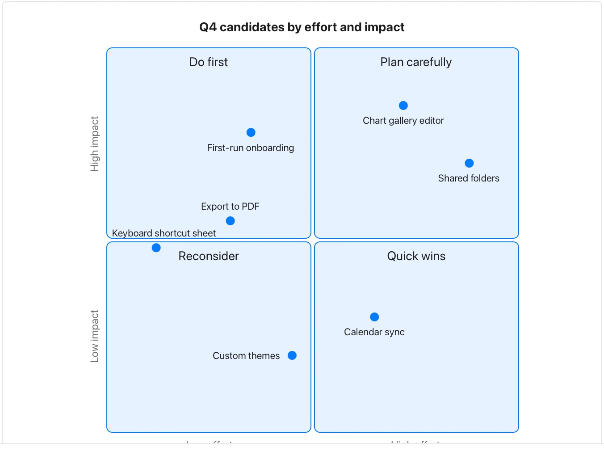

The placement is a judgment to review; a quadrant label is not a prioritization algorithm.

**Takes:** a list of items each rated on two axes, such as effort and impact, risk and reward or urgency and importance, the prioritisation matrix.

