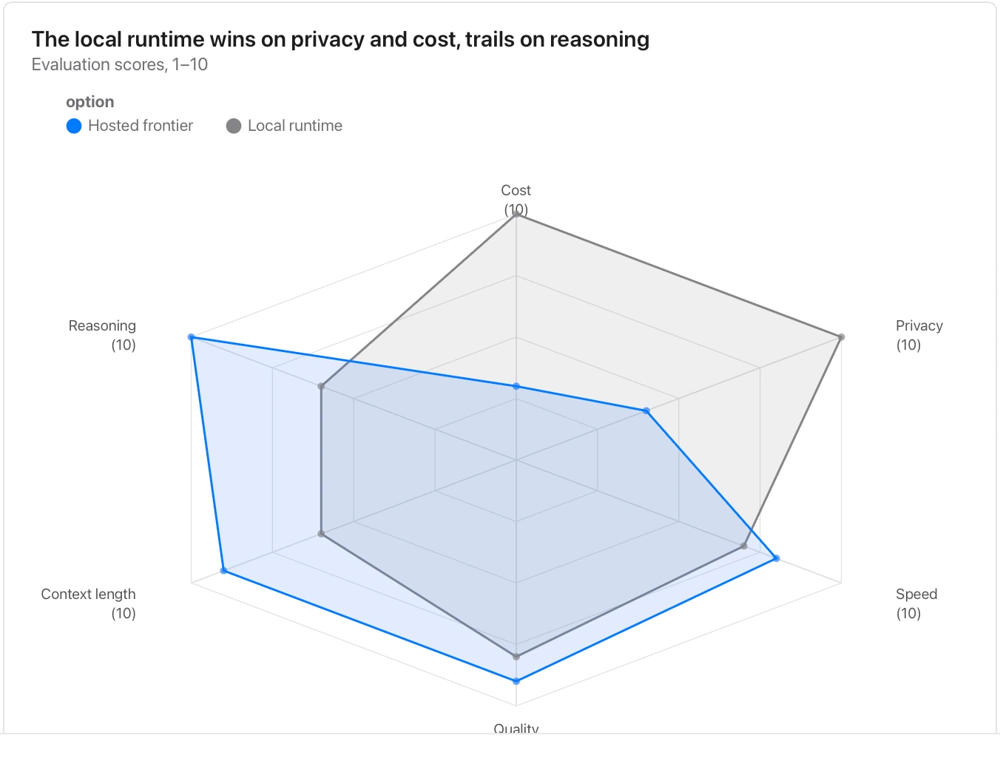

Define each score and direction, use comparable scales and inspect the table; polygon area is not a defensible overall score.

**Takes:** a table of criteria, option and score, such as a vendor evaluation or a skills matrix, with two or three options scored on five to eight axes.

