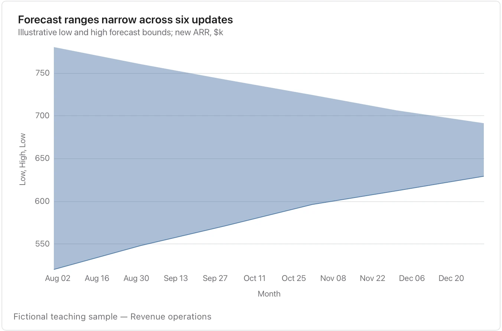

Say whether it is a forecast interval, observed spread or scenario range; Flow does not infer its statistical meaning.

**Takes:** a date column with a low and a high column, and optionally a central value, such as a forecast with its confidence band, a temperature range or a p10/p90 spread.

