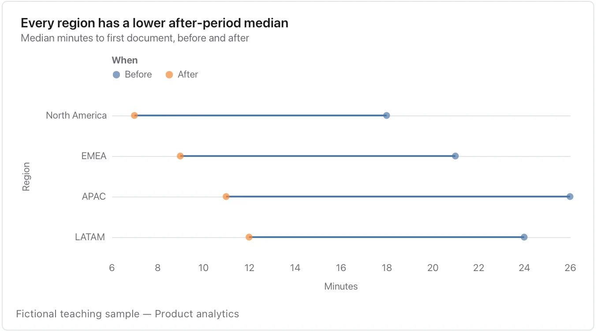

Name both endpoints; this before/after layout does not establish what caused a change.

**Takes:** a table with a category, a condition and a numeric value, with two rows per category. The before and after values appear as two dots joined by a line.

