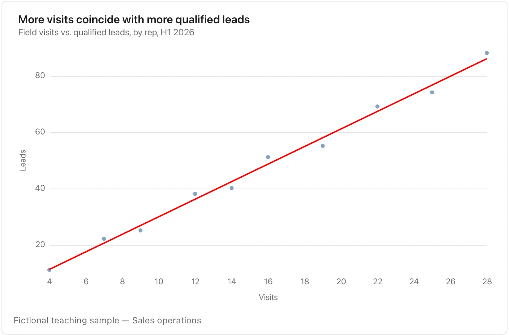

Keep the points visible and avoid causal language or predictions beyond the observed range.

**Takes:** the same two numeric columns as a scatter, when you want the fitted trend drawn through them: ad spend against signups, effort against score.

