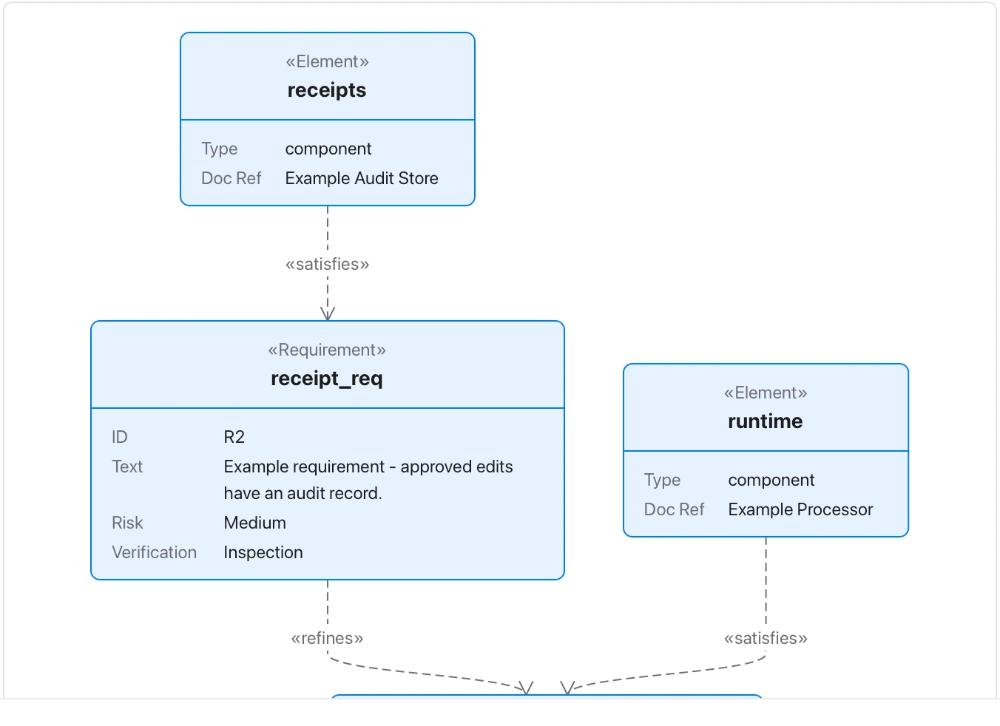

A satisfies arrow records an assertion, not completed compliance or test evidence.

**Takes:** a list of requirements with identifiers, risk and verification method, and which components satisfy them. That fits a compliance or safety document. These are fictional requirements and components, not verified Flow guarantees.

